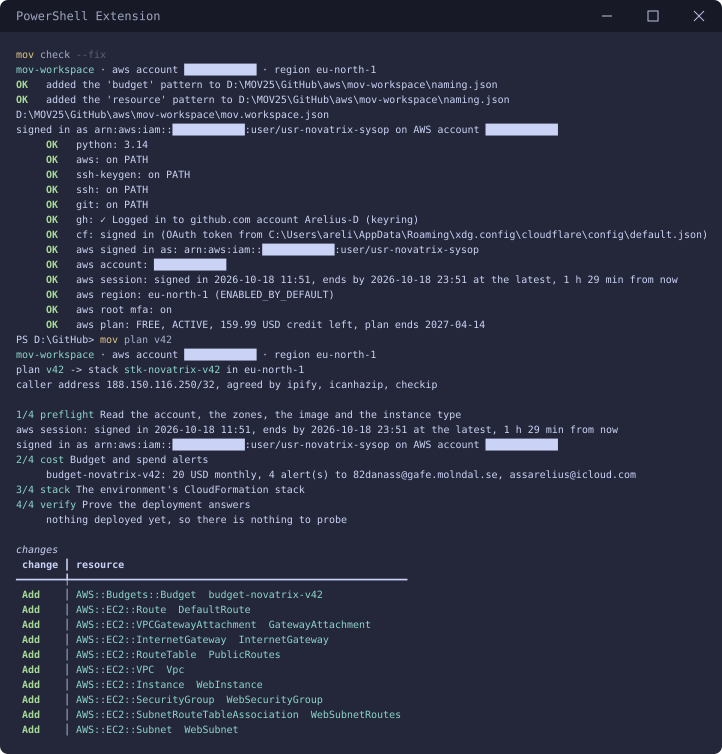
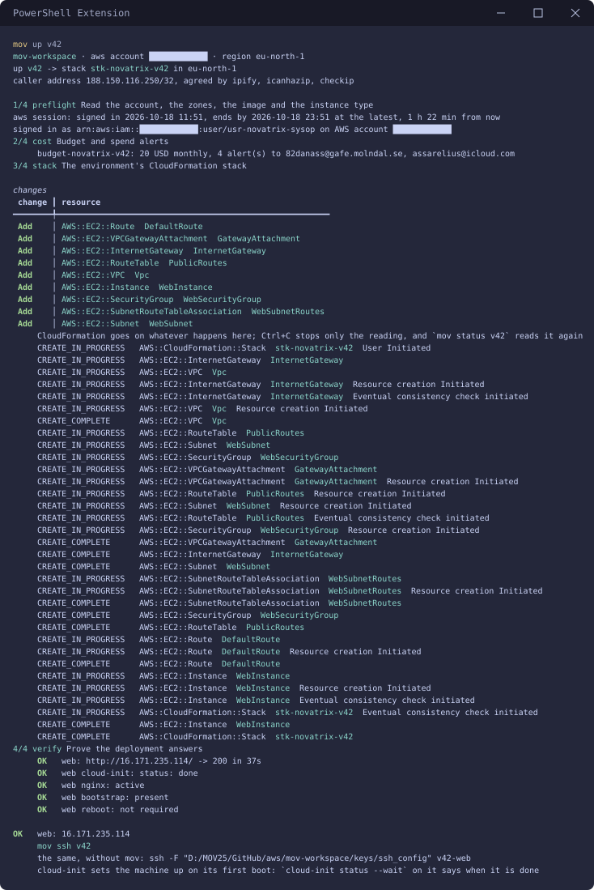
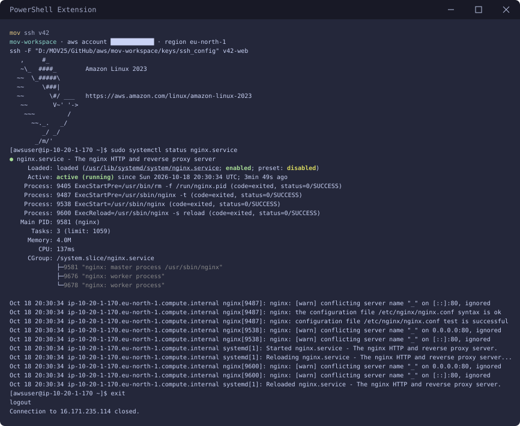
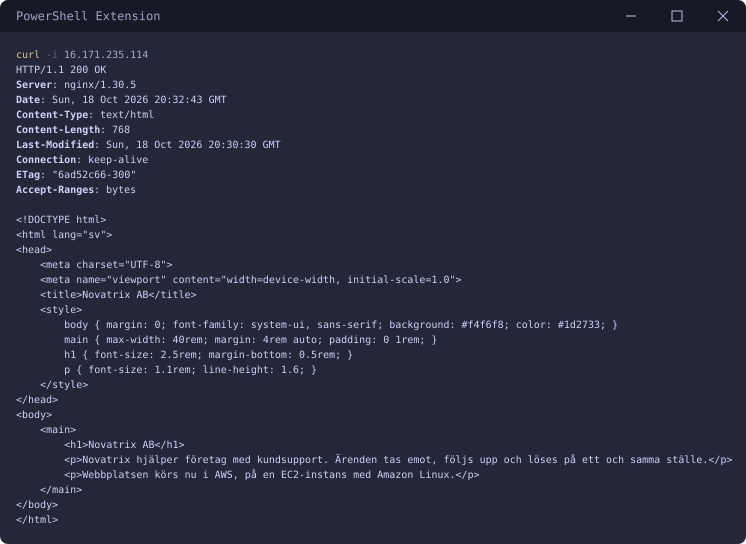
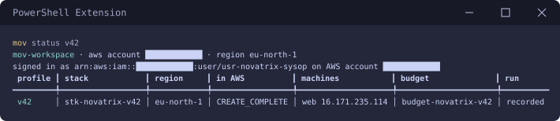
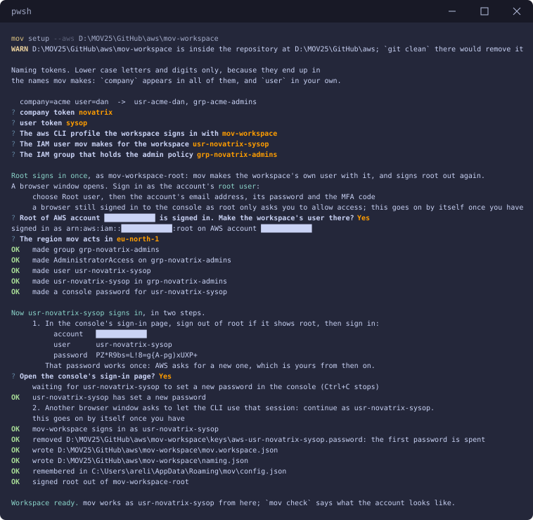
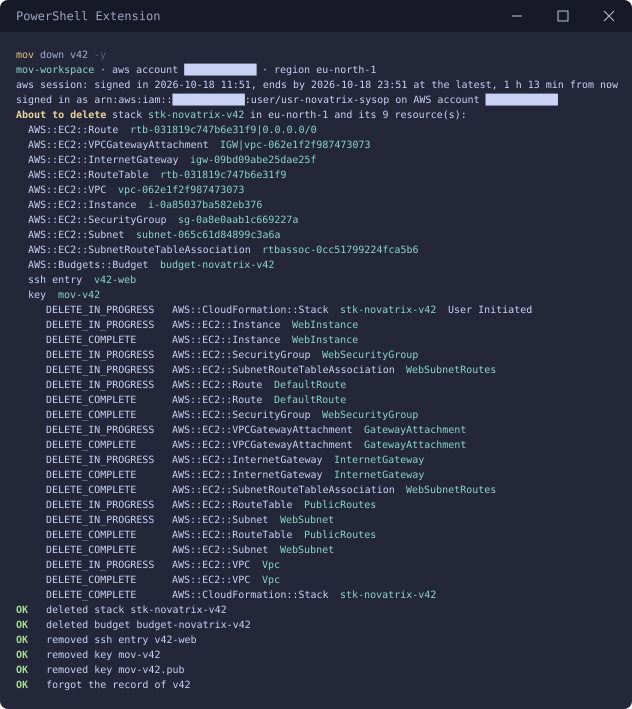

# v42 — Compute och kom igång

**Daniel Assarélius** · MOV25 · Amazon Web Services · Novatrix AB

Repo: [github.com/82danass/aws](https://github.com/82danass/aws) · Vecka: [v42](https://github.com/82danass/aws/tree/master/v42)

- [x] Sätt upp kursrepo på GitHub (README med namn, kurs, veckorubrik)
- [x] Provisionera en EC2-instans med Amazon Linux, key pair och security group
- [x] Konfigurera värdmiljön: anslut via SSH och installera en webbserver
- [x] Driftsätt webbsidan om Novatrix på instansens publika IP
- [x] Verifiera och dokumentera
- [x] Kostnadskontroll: månadsbudget i AWS Budgets med larm på faktisk och prognostiserad kostnad

## Instansen

En EC2-instans, `ec2-novatrix-v42-web`, med Amazon Linux 2023, som serverar Novatrix sida på sin publika adress.

| Val | Värde | Varför |
| --- | --- | --- |
| Image | Amazon Linux 2023 | Uppgiften vill ha Amazon Linux. Amazon Linux 2 fick sitt sista stöd 30 juni 2026, så 2023 är den som gäller. |
| Instanstyp | `t3.micro` | Kontot är på AWS Free plan, som bara kör instanstyper i free tier. `t3.micro` är en av dem och räcker för en statisk sida. |
| Disk | 8 GB gp3 | En statisk sida behöver inte mer. |
| Användare | `awsuser` | Skapas av cloud-init med nyckeln och sudo. Den har inget lösenord, så nyckeln är enda vägen in. |

Instansen och nätet runt den står i en CloudFormation-stack, `stk-novatrix-v42`: VPC, subnät, internet gateway med en route ut, security group och instansen. Allt i stacken byggs och rivs i ett stycke.

Security groupen `sgr-novatrix-v42-web`:

| Regel | Port | Källa | Varför |
| --- | --- | --- | --- |
| `ssh` | TCP 22 | min egen adress | administration, bara därifrån |
| `http` | TCP 80 | alla | sidan ska nås på instansens publika IP |

Allt annat inkommande nekas. Min adress står inte i profilen: den säger `@caller` och mov tar reda på adressen vid varje körning i stället för att jag skriver in den. HTTP utan TLS är den svagaste punkten i miljön.

**Key pair.** mov gör ett ed25519-par åt mig i `keys/mov-v42`. Den privata halvan lämnar aldrig datorn och ligger utanför repot. Den publika går in på instansen med cloud-init i instansens user data och är därför ingen egen resurs i AWS. Det är skälet till att inget key pair står på instansen i EC2-konsolen.

## Webbservern och sidan

Ingen fil laddas upp till servern. Vid första uppstarten klonar cloud-init repot och kör [`scripts/bootstrap.sh`](../scripts/bootstrap.sh) som root. Skriptet installerar nginx med dnf, lägger [`public/`](public/) i webbroten och startar nginx.

Sidan, [`public/index.html`](public/index.html):

```html
<!DOCTYPE html>
<html lang="sv">
<head>
    <meta charset="UTF-8">
    <meta name="viewport" content="width=device-width, initial-scale=1.0">
    <title>Novatrix AB</title>
    <style>
        body { margin: 0; font-family: system-ui, sans-serif; background: #f4f6f8; color: #1d2733; }
        main { max-width: 40rem; margin: 4rem auto; padding: 0 1rem; }
        h1 { font-size: 2.5rem; margin-bottom: 0.5rem; }
        p { font-size: 1.1rem; line-height: 1.6; }
    </style>
</head>
<body>
    <main>
        <h1>Novatrix AB</h1>
        <p>Novatrix hjälper företag med kundsupport. Ärenden tas emot, följs upp och löses på ett och samma ställe.</p>
        <p>Webbplatsen körs nu i AWS, på en EC2-instans med Amazon Linux.</p>
    </main>
</body>
</html>
```

## Budgeten

| Inställning | Värde |
| --- | --- |
| Namn | `budget-novatrix-v42` |
| Belopp | 20 USD i månaden |
| Larm på faktisk kostnad | över 50 %, 80 % och 90 % |
| Larm på prognostiserad kostnad | över 100 % |
| Mottagare | `82danass@gafe.molndal.se` och `assarelius@icloud.com` |

20 USD är ungefär 200 kronor. AWS Budgets tar bara USD: en budget i kronor nekas med `SEK is not in the supported unit set: [USD]`. Larmen är procent av beloppet och vart och ett går till båda adresserna.

Budgeten gäller miljön och inte hela kontot. Den räknar bara det som bär miljöns taggar `env=v42` och `managedBy=mov`. Taggarna är aktiverade som cost allocation tags i kontot, annars räknar AWS inte efter dem.

## Verifiering

`mov check --fix` och `mov plan v42` innan något finns:



`mov check` går igenom verktygen, inloggningen, regionen, root-kontots MFA och kontots plan. `mov plan v42` listar budgeten och de nio resurserna i stacken utan att skapa något.

`mov up v42`



Steg 2 gör budgeten och steg 3 stacken. Steg 4 är verifieringen, ställd till instansen och inte till mallen: sidan på den publika adressen svarar 200 med Novatrix-texten efter 37 sekunder, cloud-init är klar, nginx kör, bootstrap-skriptet har lämnat sin stämpel och instansen behöver inte startas om efter uppgraderingen. Kontrollerna står i profilens `verify`-block.

`mov ssh v42`



Inloggad som `awsuser` på Amazon Linux 2023. nginx har kört sedan uppstarten. Varningen `conflicting server name "_"` kommer av att Amazon Linux egen `nginx.conf` har en standardserver med samma namn. nginx svarar med bootstrap-skriptets server, som är märkt `default_server`.

`curl -i 16.171.235.114`



Från min dator: `200 OK` från nginx och Novatrix-sidan.

`mov status v42`



Efter varje delmoment går det att kontrollera för sig:

| Delmoment | Kontroll | Svar |
| --- | --- | --- |
| Instansen | `mov status v42` | stacken `CREATE_COMPLETE` med instansens adress |
| Webbservern | `mov ssh v42`, sedan `systemctl is-active nginx` | `active` |
| Sidan | `curl -i http://16.171.235.114/` | `200 OK` och sidan |
| Budgeten | Billing and Cost Management → Budgets i konsolen | `budget-novatrix-v42`, 20 USD i månaden |
| Allt på en gång | `mov up v42 --stage verify` | varje kontroll `OK` |

## Automatisering

Ingenting ovan är klickat fram i konsolen. I stället för lösa CLI-skript använder jag samma harness som i Azure-kursen, [mov](https://github.com/Arelius-D/mov), som nu också driver `aws` CLI: **vad** som ska byggas står i profilen, **hur** det görs sköter verktyget.

### Profil

[`mov-workspace/profiles/v42.json`](../mov-workspace/profiles/v42.json)

```json
{
  "env": "v42",
  "description": "Novatrix webbsida på EC2 med Amazon Linux, månadsbudget och verifiering",
  "stages": ["preflight", "cost", "stack", "verify"],
  "cost": {
    "amount": 20,
    "currency": "USD",
    "timeGrain": "Monthly",
    "thresholds": [
      { "percent": 50, "type": "Actual", "operator": "GreaterThan" },
      { "percent": 80, "type": "Actual", "operator": "GreaterThan" },
      { "percent": 90, "type": "Actual", "operator": "GreaterThan" },
      { "percent": 100, "type": "Forecasted", "operator": "GreaterThan" }
    ],
    "notify": { "emails": ["82danass@gafe.molndal.se", "assarelius@icloud.com"] }
  },
  "network": {
    "addressSpace": "10.20.0.0/16",
    "subnets": [{ "purpose": "web", "prefix": "10.20.1.0/24" }],
    "securityGroups": {
      "web": [
        { "name": "ssh", "ports": ["22"], "source": "${admin.sshSource}" },
        { "name": "http", "ports": ["80"], "source": "*" }
      ]
    }
  },
  "compute": {
    "vms": [
      {
        "purpose": "web",
        "image": "AmazonLinux2023",
        "subnet": "web",
        "securityGroup": "web",
        "app": true,
        "source": {
          "repo": "82danass/aws",
          "ref": "master",
          "path": "v42/public",
          "bootstrap": "scripts/bootstrap.sh",
          "auth": "public"
        }
      }
    ]
  },
  "verify": {
    "httpPath": "/",
    "expectStatus": 200,
    "expectText": "Novatrix",
    "timeoutSeconds": 600,
    "intervalSeconds": 10,
    "host": [
      { "name": "cloud-init", "run": "cloud-init status --wait >/dev/null; cloud-init status | head -n 1", "expect": "status: done" },
      { "name": "nginx", "run": "systemctl is-active nginx", "expect": "active" },
      { "name": "bootstrap", "run": "test -f /etc/mov/deployed.json && echo present", "expect": "present" }
    ]
  }
}
```

Profilen är allt som är eget för v42. Taggar, instanstyp, disk, användaren och SSH-nyckeln står i [`aws-defaults.json`](../mov-workspace/aws-defaults.json), namnmönstren i [`naming.json`](../mov-workspace/naming.json). Namnen följer kursens mönster typ-företag-syfte: `stk-novatrix-v42`, `vpc-novatrix-v42`, `snet-novatrix-v42-web`, `sgr-novatrix-v42-web`, `ec2-novatrix-v42-web` och `budget-novatrix-v42`.

### Arbetsytan

Arbetsytan och IAM-användaren som allt körs som gjorde jag en gång med `mov setup --aws`. Root loggar in en enda gång, mov gör gruppen `grp-novatrix-admins` och användaren `usr-novatrix-sysop` och loggar ut root igen. Allt därefter körs som `usr-novatrix-sysop`, aldrig som root.



### Återskapa miljön från repot

Bortsett från inloggningarna i `mov setup --aws` kräver inget steg ett klick i konsolen. Arbetsytans fil `mov.workspace.json` ligger inte i repot eftersom den bär kontots id. `mov setup --aws` skriver den.

```powershell
git clone https://github.com/82danass/aws.git
mov setup --aws .\aws\mov-workspace
cd aws\mov-workspace
mov check
mov up v42
```

Resultatet blir samma miljö med samma namn, samma region och samma budget. `verify` säger till om sidan inte svarar. En inloggning i AWS CLI varar högst tolv timmar, så nästa dag är det `aws login --profile mov-workspace --region eu-north-1` först.

### Riva miljön när jag är klar

`mov down v42 -y`



Stacken med de nio resurserna, budgeten, SSH-posten och nyckeln går. Användaren och gruppen i IAM och de aktiverade taggarna ligger kvar: de hör till kontot och inte till miljön. Nästa `mov up v42` bygger samma miljö igen.
