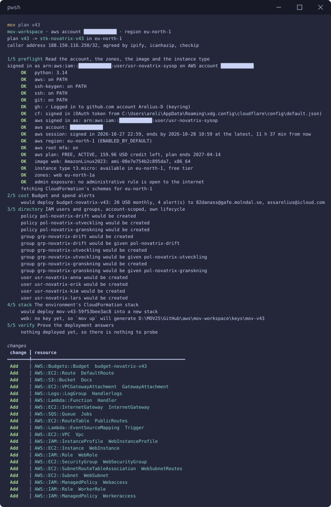
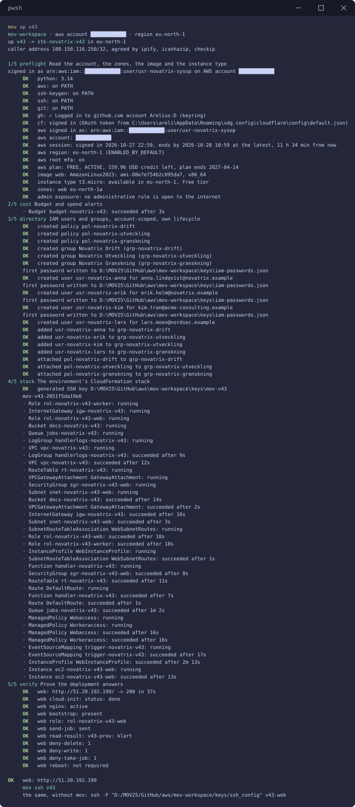
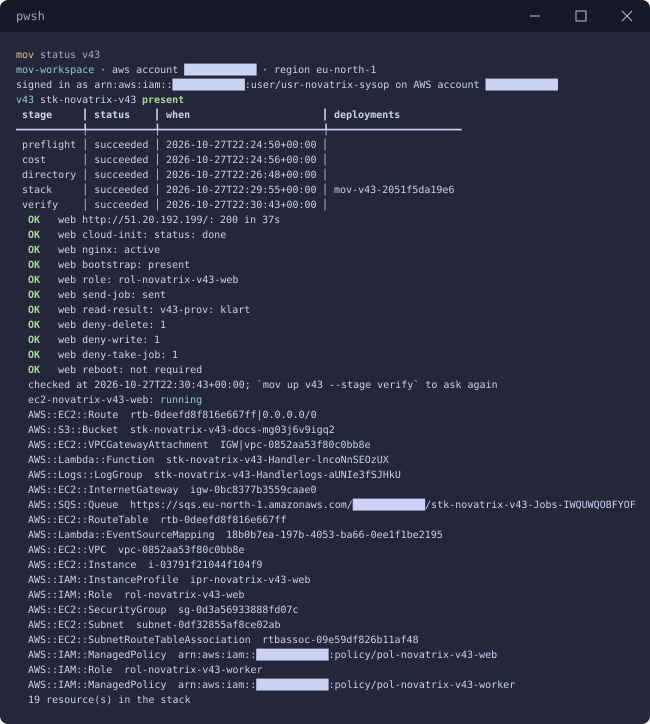
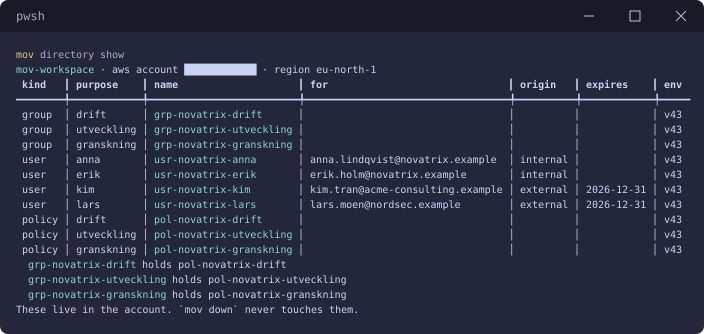
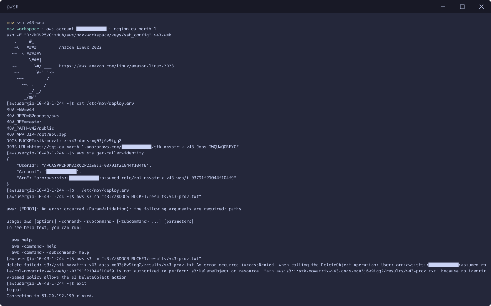
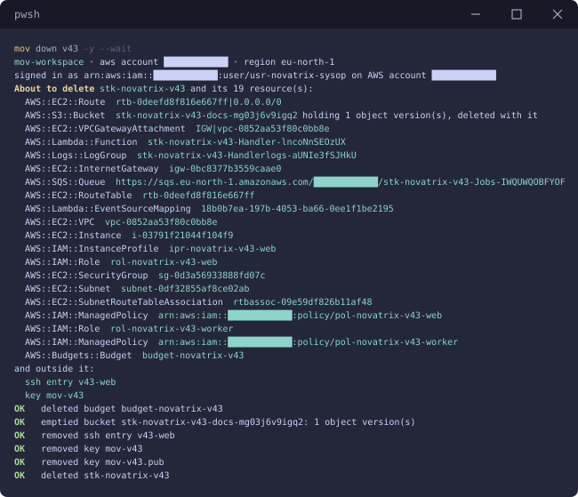

# v43 — IAM och identitet

**Daniel Assarélius** · MOV25 · Amazon Web Services · Novatrix AB

Repo: [github.com/82danass/aws](https://github.com/82danass/aws) · Vecka: [v43](https://github.com/82danass/aws/tree/master/v43)

- [x] Skapa avsnitt för v43 och uppdatera README
- [x] Skapa IAM-användare och grupper för Novatrix roller, t.ex. drift och utveckling
- [x] Skapa och koppla policies enligt least privilege
- [x] Skapa en IAM-roll som låter en AWS-tjänst nå en annan
- [x] Verifiera och dokumentera

## Människorna: grupper och användare

Novatrix har tre roller bland människorna, samma som i Azure-kursens IAM-vecka: drift, utveckling och granskning. Varje roll är en IAM-grupp med en egen policy. Varje person är en IAM-användare i den grupp som motsvarar vad personen gör. Behörigheten sitter på gruppen och aldrig på personen, så den som byter roll byter grupp.

| Grupp | Vem | Policy | Får | Får inte |
| --- | --- | --- | --- | --- |
| `grp-novatrix-drift` | Anna Lindqvist | `pol-novatrix-drift` | se maskinerna, starta, stoppa och starta om de som bär `env=v43`, läsa jobbfunktionens loggar | radera maskiner, läsa data, ändra behörigheter |
| `grp-novatrix-utveckling` | Erik Holm, Kim Tran (Acme Consulting) | `pol-novatrix-utveckling` | läsa jobbfunktionen och ladda upp ny kod, läsa resultaten och loggarna | byta funktionens roll eller inställningar, lämna över en roll, starta eller stoppa maskiner, radera data |
| `grp-novatrix-granskning` | Lars Moen (NordSec) | `pol-novatrix-granskning` | läsa Novatrix roller, grupper, användare och policies och själv köra policysimulatorn mot dem | ändra något, skapa nycklar eller lösenord, läsa data |

Användarna heter `usr-novatrix-anna`, `usr-novatrix-erik`, `usr-novatrix-kim` och `usr-novatrix-lars`. Var och en får ett första lösenord som måste bytas vid första inloggningen och den enda policy AWS har för att få byta sitt eget lösenord. Inga åtkomstnycklar skapas. Kim och Lars kommer utifrån och har ett slutdatum, 2026-12-31, som `mov directory show` säger till om när det har passerat.

Människorna hör till kontot och inte till miljön. De står i arbetsytans [`directory.json`](../mov-workspace/directory.json), skapas av steget `directory` i `mov up v43` och finns kvar när miljön rivs. Bara `mov directory down` tar bort dem.

### Varför varje policy ser ut som den gör

- **Drift.** `ec2:DescribeInstances` och `ec2:DescribeInstanceStatus` står på `*` eftersom EC2 inte kan begränsa en Describe till en enskild resurs. Start, stopp och omstart gäller bara maskiner som bär taggen `env=v43`, alltså veckans webbserver och inte allt i kontot. `ec2:TerminateInstances` finns inte med: att riva en maskin är en ändring i profilen och inte i driften.
- **Utveckling.** `lambda:UpdateFunctionCode` men inte `lambda:UpdateFunctionConfiguration`: koden får ändras men inte vilken roll funktionen kör som. Eftersom `iam:PassRole` saknas kan utveckling inte heller ge funktionen en annan roll. Resultaten under `results/` går att läsa för felsökning men inte att skriva eller radera.
- **Granskning.** Bara läsning och bara av det som heter `rol-novatrix-*`, `grp-novatrix-*`, `usr-novatrix-*` och `pol-novatrix-*`. Granskning får köra policysimulatorn mot Novatrix roller och användare och kan alltså själv pröva det jag påstår här.

Policyerna pekar ut veckans resurser med taggen `env=v43` och med namnmönster som `stk-novatrix-v43-*`. Kontots id står ingenstans i repot.

## Tjänst till tjänst: kedjan

| Led | Tjänst | Kör som | Får | Får inte |
| --- | --- | --- | --- | --- |
| 1 | Webbservern (EC2) | `rol-novatrix-v43-web` genom instansprofilen `ipr-novatrix-v43-web` | lägga jobb på kön, läsa resultat under `results/` | ta jobb från kön, skriva eller radera i bucketen |
| 2 | Kön (SQS) | | | |
| 3 | Jobbfunktionen (Lambda) | `rol-novatrix-v43-worker` | ta och ta bort jobb från kön, skriva under `results/`, logga till sin egen loggrupp | läsa tillbaka det den skrev, lägga jobb på kön |
| 4 | Bucketen (S3) | | | |

Webbservern lägger ett jobb på kön. Jobbfunktionen startas av kön, skriver resultatet som en fil under `results/` i bucketen och webbservern läser filen. Varje led når bara nästa led. Bryter sig någon in på webbservern kan den lägga jobb och läsa resultat men inte radera, skriva över eller läsa något annat. Funktionen kan bara skriva under `results/` och läser ingenting, så en bugg i koden kan inte läcka data ur bucketen.

Rollerna har inga behörigheter i sig. Vem som får anta en roll bestäms av vad som använder den: webbservern kör som `web`, så `web` litar på EC2. Funktionen kör som `worker`, så `worker` litar på Lambda. Vad rollerna får göra står i en policy per roll, `pol-novatrix-v43-web` och `pol-novatrix-v43-worker`, som pekar ut rollen.

Webbservern har inga åtkomstnycklar. Den får tillfälliga nycklar från instansprofilen genom instansens metadata. IMDSv2 krävs på instansen. Bucketens namn och köns adress hamnar i `/etc/mov/deploy.env` på maskinen, utfyllda av CloudFormation, så ingenting på maskinen gissar dem.

| Resurs | Inställning | Varför |
| --- | --- | --- |
| Bucketen | Block Public Access på alla fyra, SSE-S3, BucketOwnerEnforced, `results/` rensas efter 7 dagar | privat, krypterad, inga ACL:er, inget blir liggande |
| Kön | SSE-SQS, meddelanden lever en timme, synlighetstid 60 s mot funktionens 10 s | krypterad, ett jobb hinner köras klart innan det syns igen |
| Loggruppen | sparas en dag och ägs av stacken | rivs med stacken. Annars gör Lambda en egen `/aws/lambda/...` som blir kvar |

## Verifiering

`mov check --fix` och `mov plan v43` innan något finns:



`mov plan v43` listar budgeten, människorna och stacken utan att skapa något.

`mov up v43`



Steg 2 gör budgeten, steg 3 människorna och steg 4 stacken. Steg 5 är verifieringen. Kontrollerna står i profilens `verify`-block och körs på maskinen över SSH:

| Kontroll | Vad den visar | Svar |
| --- | --- | --- |
| sidan | Novatrix-sidan på den publika adressen | `200` efter 37 sekunder |
| `role` | vem maskinen kör som | `rol-novatrix-v43-web` |
| `send-job` | webbservern får lägga ett jobb på kön | `sent` |
| `read-result` | jobbfunktionen har tagit jobbet och skrivit ett resultat som webbservern får läsa | `v43-prov: klart` |
| `deny-delete` | webbservern nekas radera i bucketen | `AccessDenied` |
| `deny-write` | webbservern nekas skriva i bucketen | `AccessDenied` |
| `deny-take-job` | webbservern nekas ta jobb från kön | `AccessDenied` |

Hela kedjan har alltså gått igenom: jobbet från webbservern via kön och funktionen till bucketen och tillbaka. Det som ska nekas nekas.

`mov status v43`



`mov directory show`



`mov ssh v43`



På maskinen står bucketens namn och köns adress i `/etc/mov/deploy.env`. `aws sts get-caller-identity` visar att maskinen kör som rollen `rol-novatrix-v43-web` med tillfälliga nycklar och inga egna. Raderingen nekas med `AccessDenied` eftersom ingen policy ger rollen `s3:DeleteObject`. I bilden saknar `aws s3 cp` sitt sista `-`, så den raden visar bara CLI:ns hjälptext. Läsningen syns i stället i verifieringens `read-result`.

### Människornas behörigheter med IAM:s policysimulator

Människorna har varken lösenord de använt eller nycklar, så deras behörigheter prövas med IAM:s egen policysimulator, `aws iam simulate-principal-policy`, mot veckans riktiga resurser. Granskning får själv köra samma simulator.

| Användare | Åtgärd | Svar |
| --- | --- | --- |
| anna (drift) | starta, stoppa och starta om webbservern | tillåts |
| anna (drift) | radera webbservern | nekas |
| anna (drift) | läsa resultat i bucketen | nekas |
| erik (utveckling) | läsa jobbfunktionen och ladda upp ny kod | tillåts |
| erik (utveckling) | ändra funktionens inställningar | nekas |
| erik (utveckling) | läsa resultat i bucketen | tillåts |
| erik (utveckling) | stoppa webbservern | nekas |
| kim (utveckling) | ladda upp ny kod till jobbfunktionen | tillåts |
| kim (utveckling) | lämna över jobbfunktionens roll (`iam:PassRole`) | nekas |
| lars (granskning) | läsa webbserverns roll och dess policies | tillåts |
| lars (granskning) | köra simulatorn mot anna | tillåts |
| lars (granskning) | koppla en policy till en roll, skapa åtkomstnycklar | nekas |
| lars (granskning) | läsa resultat i bucketen | nekas |
| rollen `web` | lägga jobb på kön | tillåts |
| rollen `web` | ta jobb från kön | nekas |

Efter varje delmoment går det att kontrollera för sig:

| Delmoment | Kontroll | Svar |
| --- | --- | --- |
| Användare och grupper | `mov directory show` | fyra användare i tre grupper |
| Policies | `mov directory show` | varje grupp med sin policy |
| Rollen mellan tjänster | `mov ssh v43`, sedan `aws sts get-caller-identity` | `assumed-role/rol-novatrix-v43-web` |
| Kedjan och det som nekas | `mov up v43 --stage verify` | varje kontroll `OK` |

## Automatisering

Ingenting ovan är klickat fram i konsolen. Som i v42 bygger [mov](https://github.com/Arelius-D/mov) allt: **vad** som ska finnas står i två filer i repot, **hur** det görs sköter verktyget.

### Människorna

[`mov-workspace/directory.json`](../mov-workspace/directory.json) hör till kontot och inte till en miljö:

```json
{
  "$schema": "https://raw.githubusercontent.com/Arelius-D/mov/main/src/mov/data/schema/aws-directory.schema.json",
  "policies": [
    {
      "purpose": "drift",
      "description": "Drift kör och lagar v43: ser maskinerna, startar, stoppar och startar om dem som bär env=v43 och läser jobbfunktionens loggar. Kan inte radera maskiner, läsa data eller ändra behörigheter.",
      "document": {
        "Version": "2012-10-17",
        "Statement": [
          { "Sid": "SeeMachines", "Effect": "Allow", "Action": ["ec2:DescribeInstances", "ec2:DescribeInstanceStatus"], "Resource": "*" },
          { "Sid": "RunV43Machines", "Effect": "Allow", "Action": ["ec2:StartInstances", "ec2:StopInstances", "ec2:RebootInstances"], "Resource": "arn:aws:ec2:eu-north-1:*:instance/*", "Condition": { "StringEquals": { "aws:ResourceTag/env": "v43" } } },
          { "Sid": "ReadHandlerLogs", "Effect": "Allow", "Action": ["logs:DescribeLogStreams", "logs:GetLogEvents", "logs:FilterLogEvents"], "Resource": "arn:aws:logs:eu-north-1:*:log-group:stk-novatrix-v43-*" }
        ]
      }
    },
    {
      "purpose": "utveckling",
      "description": "Utveckling ändrar jobbfunktionens kod och felsöker: läser funktionen, laddar upp ny kod och läser resultaten och loggarna. Kan inte byta funktionens roll eller inställningar, starta eller stoppa maskiner eller radera data.",
      "document": {
        "Version": "2012-10-17",
        "Statement": [
          { "Sid": "ChangeHandlerCode", "Effect": "Allow", "Action": ["lambda:GetFunction", "lambda:UpdateFunctionCode"], "Resource": "arn:aws:lambda:eu-north-1:*:function:stk-novatrix-v43-*" },
          { "Sid": "ReadResults", "Effect": "Allow", "Action": "s3:GetObject", "Resource": "arn:aws:s3:::stk-novatrix-v43-docs-*/results/*" },
          { "Sid": "ReadHandlerLogs", "Effect": "Allow", "Action": ["logs:DescribeLogStreams", "logs:GetLogEvents", "logs:FilterLogEvents"], "Resource": "arn:aws:logs:eu-north-1:*:log-group:stk-novatrix-v43-*" }
        ]
      }
    },
    {
      "purpose": "granskning",
      "description": "Granskning läser Novatrix roller, grupper, användare och policies och kör själv IAM:s policysimulator mot dem. Ändrar ingenting och läser ingen data.",
      "document": {
        "Version": "2012-10-17",
        "Statement": [
          { "Sid": "ReadIdentities", "Effect": "Allow", "Action": ["iam:GetRole", "iam:ListAttachedRolePolicies", "iam:GetGroup", "iam:ListAttachedGroupPolicies", "iam:GetUser", "iam:ListGroupsForUser", "iam:ListAttachedUserPolicies"], "Resource": ["arn:aws:iam::*:role/rol-novatrix-*", "arn:aws:iam::*:group/grp-novatrix-*", "arn:aws:iam::*:user/usr-novatrix-*"] },
          { "Sid": "ReadPolicies", "Effect": "Allow", "Action": ["iam:GetPolicy", "iam:GetPolicyVersion"], "Resource": "arn:aws:iam::*:policy/pol-novatrix-*" },
          { "Sid": "Simulate", "Effect": "Allow", "Action": ["iam:SimulatePrincipalPolicy", "iam:GetContextKeysForPrincipalPolicy"], "Resource": ["arn:aws:iam::*:role/rol-novatrix-*", "arn:aws:iam::*:user/usr-novatrix-*"] }
        ]
      }
    }
  ],
  "groups": [
    { "purpose": "drift", "displayName": "Novatrix Drift", "description": "Kör och lagar miljön.", "policies": [{ "policy": "drift" }] },
    { "purpose": "utveckling", "displayName": "Novatrix Utveckling", "description": "Ändrar jobbfunktionens kod och felsöker.", "policies": [{ "policy": "utveckling" }] },
    { "purpose": "granskning", "displayName": "Novatrix Granskning", "description": "Läser allt om behörigheterna, ändrar ingenting.", "policies": [{ "policy": "granskning" }] }
  ],
  "users": [
    { "purpose": "anna", "displayName": "Anna Lindqvist (drift)", "groups": ["drift"], "for": "anna.lindqvist@novatrix.example", "origin": "internal" },
    { "purpose": "erik", "displayName": "Erik Holm (utveckling)", "groups": ["utveckling"], "for": "erik.holm@novatrix.example", "origin": "internal" },
    { "purpose": "kim", "displayName": "Kim Tran (Acme Consulting)", "groups": ["utveckling"], "for": "kim.tran@acme-consulting.example", "origin": "external", "expires": "2026-12-31" },
    { "purpose": "lars", "displayName": "Lars Moen (NordSec)", "groups": ["granskning"], "for": "lars.moen@nordsec.example", "origin": "external", "expires": "2026-12-31" }
  ]
}
```

### Profil

[`mov-workspace/profiles/v43.json`](../mov-workspace/profiles/v43.json) bygger vidare på v42 med `extends`. Nätet, maskinens storlek, budgeten och sidan kommer därifrån:

```json
{
  "env": "v43",
  "extends": "v42",
  "description": "IAM för Novatrix: människorna i arbetsytans directory.json, grupperna drift, utveckling och granskning med var sin policy enligt least privilege och en användare per person. En kedja av tjänster där varje led har en egen roll som når nästa led och inget annat: webbservern lägger jobb på en SQS-kö, en Lambda-funktion tar dem och skriver resultatet i en S3-bucket, webbservern läser resultatet.",
  "stages": ["preflight", "cost", "directory", "stack", "verify"],
  "network": {
    "addressSpace": "10.43.0.0/16",
    "subnets": [{ "purpose": "web", "prefix": "10.43.1.0/24" }]
  },
  "identity": {
    "userAssigned": [
      { "purpose": "web", "description": "Webbservern: lägger jobb på kön och läser resultaten ur bucketen, inget annat." },
      { "purpose": "worker", "description": "Jobbfunktionen: tar jobb från kön, skriver resultatet i bucketen och loggar, inget annat." }
    ]
  },
  "compute": {
    "vms": [
      {
        "purpose": "web",
        "image": "AmazonLinux2023",
        "subnet": "web",
        "securityGroup": "web",
        "app": true,
        "identities": ["web"],
        "environment": {
          "DOCS_BUCKET": "@resourceId:docs",
          "JOBS_URL": "@resourceId:jobs"
        },
        "source": {
          "repo": "82danass/aws",
          "ref": "master",
          "path": "v42/public",
          "bootstrap": "scripts/bootstrap.sh",
          "auth": "public"
        }
      }
    ]
  },
  "resources": [
    {
      "type": "AWS::S3::Bucket",
      "purpose": "docs",
      "properties": {
        "PublicAccessBlockConfiguration": { "BlockPublicAcls": true, "BlockPublicPolicy": true, "IgnorePublicAcls": true, "RestrictPublicBuckets": true },
        "OwnershipControls": { "Rules": [{ "ObjectOwnership": "BucketOwnerEnforced" }] },
        "BucketEncryption": { "ServerSideEncryptionConfiguration": [{ "ServerSideEncryptionByDefault": { "SSEAlgorithm": "AES256" } }] },
        "LifecycleConfiguration": { "Rules": [{ "Id": "results", "Status": "Enabled", "Prefix": "results/", "ExpirationInDays": 7 }] }
      }
    },
    {
      "type": "AWS::SQS::Queue",
      "purpose": "jobs",
      "properties": { "SqsManagedSseEnabled": true, "MessageRetentionPeriod": 3600, "VisibilityTimeout": 60 }
    },
    {
      "type": "AWS::Logs::LogGroup",
      "purpose": "handlerlogs",
      "properties": { "RetentionInDays": 1 }
    },
    {
      "type": "AWS::Lambda::Function",
      "purpose": "handler",
      "properties": {
        "Description": "Tar ett jobb från kön och skriver resultatet i bucketen under results/.",
        "Runtime": "python3.12",
        "Handler": "index.handler",
        "Timeout": 10,
        "MemorySize": 128,
        "Role": "@attribute:worker.Arn",
        "LoggingConfig": { "LogGroup": "@resourceId:handlerlogs" },
        "Environment": { "Variables": { "DOCS_BUCKET": "@resourceId:docs" } },
        "Code": {
          "ZipFile": {
            "Fn::Join": ["\n", [
              "import os",
              "import re",
              "import boto3",
              "",
              "s3 = boto3.client('s3')",
              "JOB = re.compile(r'^[a-z0-9-]{1,64}$')",
              "",
              "",
              "def handler(event, context):",
              "    for record in event['Records']:",
              "        job = record['body'].strip()",
              "        if not JOB.match(job):",
              "            print(f'skipped {record[\"messageId\"]}: not a job name')",
              "            continue",
              "        key = f'results/{job}.txt'",
              "        s3.put_object(Bucket=os.environ['DOCS_BUCKET'], Key=key, Body=f'{job}: klart\\n'.encode())",
              "        print(f'wrote {key}')",
              ""
            ]]
          }
        }
      }
    },
    {
      "type": "AWS::IAM::ManagedPolicy",
      "purpose": "workeraccess",
      "name": "pol-novatrix-${env}-worker",
      "properties": {
        "ManagedPolicyName": "pol-novatrix-${env}-worker",
        "Description": "Jobbfunktionens behörigheter: ta och ta bort jobb från kön, skriva resultat under results/, logga till sin egen loggrupp.",
        "Roles": ["@resourceId:worker"],
        "PolicyDocument": {
          "Version": "2012-10-17",
          "Statement": [
            { "Sid": "TakeJobs", "Effect": "Allow", "Action": ["sqs:ReceiveMessage", "sqs:DeleteMessage", "sqs:GetQueueAttributes"], "Resource": "@attribute:jobs.Arn" },
            { "Sid": "WriteResults", "Effect": "Allow", "Action": "s3:PutObject", "Resource": { "Fn::Sub": "${Docs.Arn}/results/*" } },
            { "Sid": "Log", "Effect": "Allow", "Action": ["logs:CreateLogStream", "logs:PutLogEvents"], "Resource": "@attribute:handlerlogs.Arn" }
          ]
        }
      }
    },
    {
      "type": "AWS::Lambda::EventSourceMapping",
      "purpose": "trigger",
      "dependsOn": ["workeraccess"],
      "properties": { "EventSourceArn": "@attribute:jobs.Arn", "FunctionName": "@resourceId:handler", "BatchSize": 1 }
    },
    {
      "type": "AWS::IAM::ManagedPolicy",
      "purpose": "webaccess",
      "name": "pol-novatrix-${env}-web",
      "properties": {
        "ManagedPolicyName": "pol-novatrix-${env}-web",
        "Description": "Webbserverns behörigheter: lägga jobb på kön och läsa resultaten under results/.",
        "Roles": ["@resourceId:web"],
        "PolicyDocument": {
          "Version": "2012-10-17",
          "Statement": [
            { "Sid": "SendJobs", "Effect": "Allow", "Action": "sqs:SendMessage", "Resource": "@attribute:jobs.Arn" },
            { "Sid": "ReadResults", "Effect": "Allow", "Action": "s3:GetObject", "Resource": { "Fn::Sub": "${Docs.Arn}/results/*" } }
          ]
        }
      }
    }
  ],
  "verify": {
    "host": [
      { "name": "cloud-init", "run": "cloud-init status --wait >/dev/null; cloud-init status | head -n 1", "expect": "status: done" },
      { "name": "nginx", "run": "systemctl is-active nginx", "expect": "active" },
      { "name": "bootstrap", "run": "test -f /etc/mov/deployed.json && echo present", "expect": "present" },
      { "name": "role", "run": "aws sts get-caller-identity --query Arn --output text | cut -d/ -f2", "expect": "rol-novatrix-${env}-web" },
      { "name": "send-job", "run": ". /etc/mov/deploy.env && aws sqs send-message --queue-url \"$JOBS_URL\" --message-body ${env}-prov --query MessageId --output text >/dev/null && echo sent", "expect": "sent" },
      { "name": "read-result", "run": ". /etc/mov/deploy.env && aws s3 cp \"s3://$DOCS_BUCKET/results/${env}-prov.txt\" -", "expect": "${env}-prov: klart" },
      { "name": "deny-delete", "run": ". /etc/mov/deploy.env && aws s3 rm \"s3://$DOCS_BUCKET/results/${env}-prov.txt\" 2>&1 | grep -c AccessDenied", "expect": "1" },
      { "name": "deny-write", "run": ". /etc/mov/deploy.env && echo x | aws s3 cp - \"s3://$DOCS_BUCKET/results/annat.txt\" 2>&1 | grep -c AccessDenied", "expect": "1" },
      { "name": "deny-take-job", "run": ". /etc/mov/deploy.env && aws sqs receive-message --queue-url \"$JOBS_URL\" 2>&1 | grep -c AccessDenied", "expect": "1" }
    ]
  }
}
```

`identity` gör rollerna. Vem som får anta en roll bestäms av vad som använder den: maskinen kör som `web` och funktionen pekar ut `worker` som sin roll. Rollernas behörigheter står i de två `AWS::IAM::ManagedPolicy` som pekar ut rollerna. Maskinens `environment` hamnar i `/etc/mov/deploy.env`. Namnen följer kursens mönster typ-företag-syfte: `rol-novatrix-v43-web`, `ipr-novatrix-v43-web`, `grp-novatrix-drift`, `usr-novatrix-anna` och `pol-novatrix-drift`.

### Återskapa miljön från repot

```powershell
git clone https://github.com/82danass/aws.git
mov setup --aws .\aws\mov-workspace
cd aws\mov-workspace
mov check --fix
mov up v43
```

En inloggning i AWS CLI varar högst tolv timmar, så nästa dag är det `mov use --login` först.

### Riva miljön när jag är klar

`mov down v43 -y --wait`



Bucketen töms först eftersom CloudFormation inte raderar en bucket som innehåller något. Sedan går budgeten, stacken, SSH-posten och nyckeln. Människorna ligger kvar eftersom de hör till kontot: `mov directory down -y` tar bort användarna, grupperna och policyerna.
