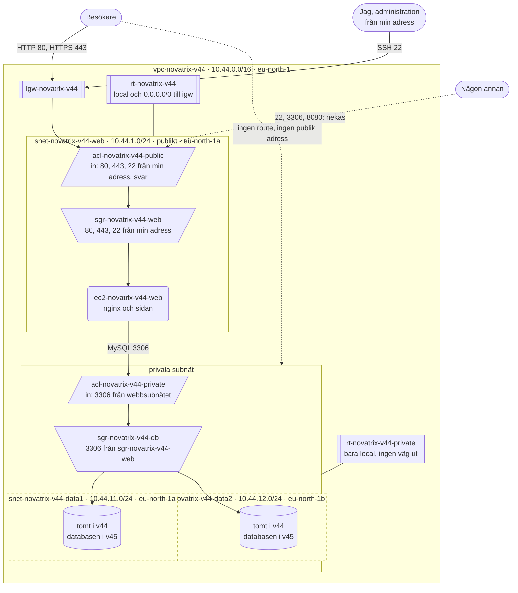
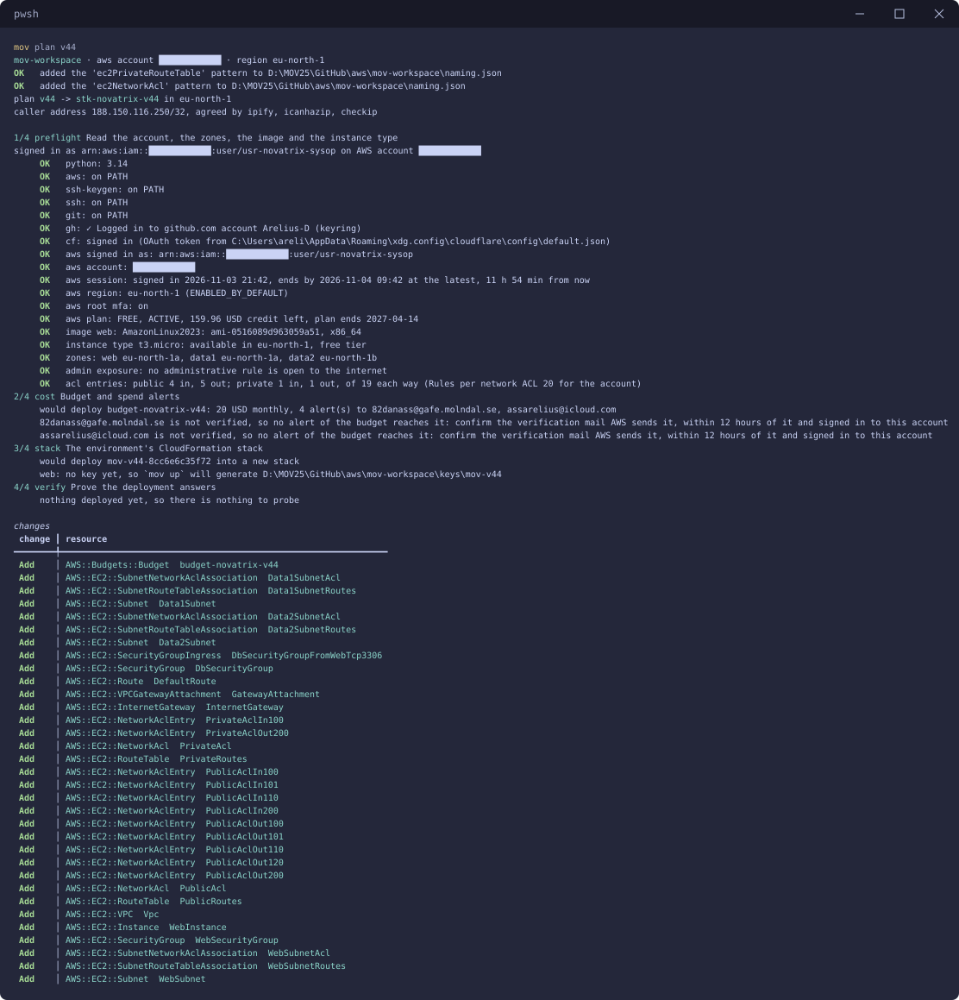
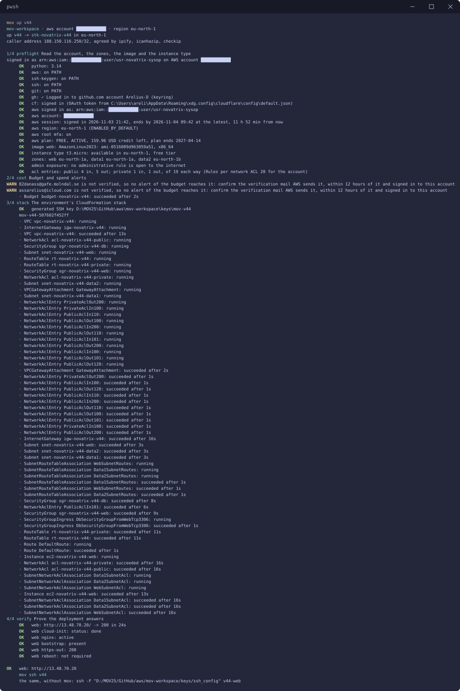
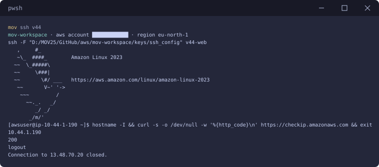
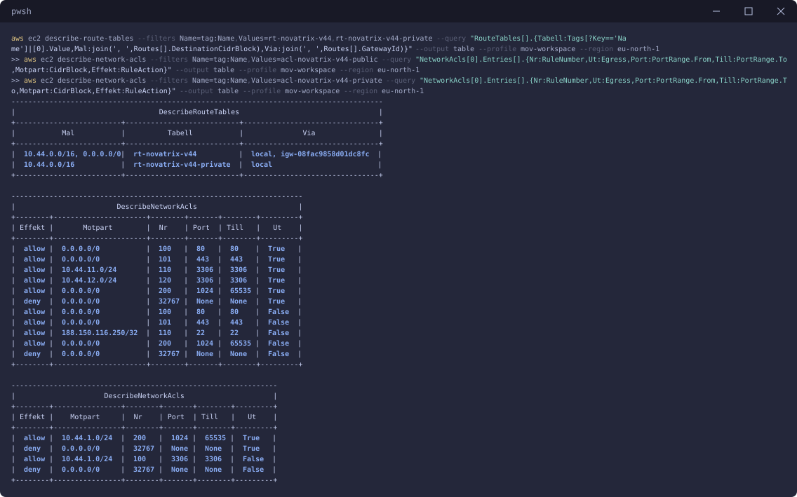
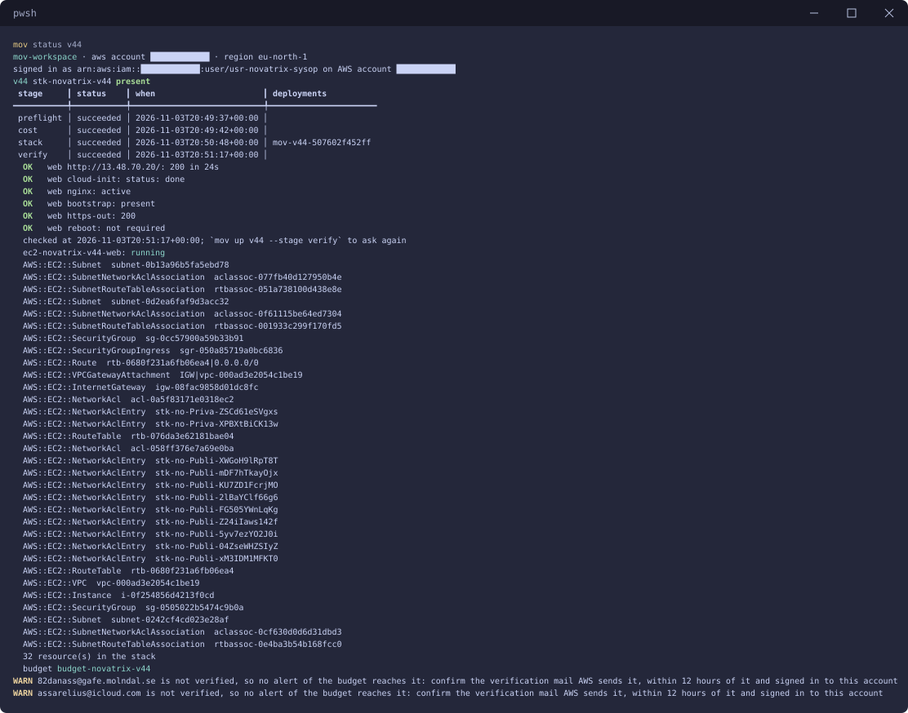
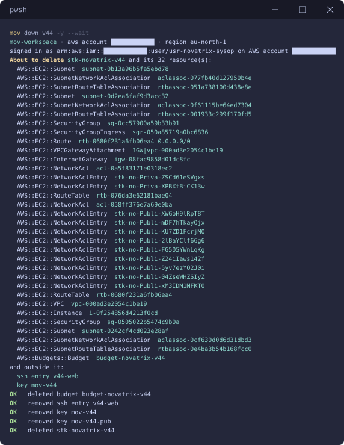

# v44 — Nätverk och säkerhet

**Daniel Assarélius** · MOV25 · Amazon Web Services · Novatrix AB

Repo: [github.com/82danass/aws](https://github.com/82danass/aws) · Vecka: [v44](https://github.com/82danass/aws/tree/master/v44)

- [x] Skapa avsnitt för v44 och uppdatera README
- [x] Bygg ett VPC med publika och privata subnät, route tables och internet gateway
- [x] Säkra trafiken med security groups och NACL:er
- [x] Placera webbservern i ett publikt subnät och förbered ett privat subnät för databasen
- [x] Verifiera och dokumentera nätverket med en skiss

## Nätverket

Webbservern och sidan från v42, nu i ett nätverk som är delat i skikt. Ett VPC, `vpc-novatrix-v44`, med adressrymden `10.44.0.0/16`, ett publikt subnät för webbservern och två privata för databasen som kommer i v45:

| Subnät | Prefix | Zon | Route table | NACL | Vad som ligger där |
| --- | --- | --- | --- | --- | --- |
| `snet-novatrix-v44-web` | `10.44.1.0/24` | `eu-north-1a` | `rt-novatrix-v44` | `acl-novatrix-v44-public` | `ec2-novatrix-v44-web`, nginx och sidan |
| `snet-novatrix-v44-data1` | `10.44.11.0/24` | `eu-north-1a` | `rt-novatrix-v44-private` | `acl-novatrix-v44-private` | tomt i v44, databasen i v45 |
| `snet-novatrix-v44-data2` | `10.44.12.0/24` | `eu-north-1b` | `rt-novatrix-v44-private` | `acl-novatrix-v44-private` | tomt i v44, databasen i v45 |

Två privata subnät i två zoner är inte för mycket. RDS kräver en subnet group med subnät i minst två zoner, så v45 ska bara behöva lägga till databasen och inte rita om nätverket.

| Route table | Mål | Via | Subnät |
| --- | --- | --- | --- |
| `rt-novatrix-v44` | `10.44.0.0/16` | `local` | web |
| | `0.0.0.0/0` | `igw-novatrix-v44` | |
| `rt-novatrix-v44-private` | `10.44.0.0/16` | `local` | data1, data2 |

Det privata route table har ingen route ut. Det är det som gör subnäten privata och inte namnet: ingenting i data1 eller data2 når internet eller nås därifrån, oavsett vad reglerna säger. Inget i dataskiktet får heller en publik adress.



## Regler

Varje väg in går genom två lager: NACL:en på subnätet och security groupen på maskinen. De fungerar olika och det är därför båda behövs.

| | Security group | NACL |
| --- | --- | --- |
| Sitter på | maskinen | subnätet |
| Minns svaret | ja, ett svar släpps alltid tillbaka | nej, svaret behöver en egen regel |
| Regler | bara Tillåt | Tillåt och Neka |
| Ordning | alla regler gäller | lägsta numret först, sist nekas allt |

`sgr-novatrix-v44-web`

| Regel | Port | Källa | Varför |
| --- | --- | --- | --- |
| `http` | TCP 80 | alla | sidan ska nås |
| `https` | TCP 443 | alla | reserverad för TLS |
| `ssh` | TCP 22 | min egen adress | administration, bara därifrån |

`sgr-novatrix-v44-db`

| Regel | Port | Källa | Varför |
| --- | --- | --- | --- |
| `mysql` | TCP 3306 | `sgr-novatrix-v44-web` | bara webbservern når databasen i v45 |

Källan till `mysql` är en annan security group och inte ett adressområde. Det som släpps in är maskiner som bär `sgr-novatrix-v44-web`, oavsett adress. En maskin som hamnar i webbsubnätet utan den gruppen kommer inte åt databasen.

`acl-novatrix-v44-public`

| Nr | Regel | Riktning | Port | Motpart | Effekt |
| --- | --- | --- | --- | --- | --- |
| 100 | `web-in` | in | TCP 80 | alla | Tillåt |
| 101 | `web-in` | in | TCP 443 | alla | Tillåt |
| 110 | `ssh-in` | in | TCP 22 | min egen adress | Tillåt |
| 200 | `replies-in` | in | TCP 1024-65535 | alla | Tillåt |
| `*` | | in | alla | alla | Neka |
| 100 | `updates-out` | ut | TCP 80 | alla | Tillåt |
| 101 | `updates-out` | ut | TCP 443 | alla | Tillåt |
| 110 | `db-data1-out` | ut | TCP 3306 | `10.44.11.0/24` | Tillåt |
| 120 | `db-data2-out` | ut | TCP 3306 | `10.44.12.0/24` | Tillåt |
| 200 | `replies-out` | ut | TCP 1024-65535 | alla | Tillåt |
| `*` | | ut | alla | alla | Neka |

`acl-novatrix-v44-private`

| Nr | Regel | Riktning | Port | Motpart | Effekt |
| --- | --- | --- | --- | --- | --- |
| 100 | `db-from-web` | in | TCP 3306 | `10.44.1.0/24` | Tillåt |
| `*` | | in | alla | alla | Neka |
| 200 | `replies-to-web` | ut | TCP 1024-65535 | `10.44.1.0/24` | Tillåt |
| `*` | | ut | alla | alla | Neka |

Två saker är värda att stanna vid. En NACL minns inget, så svaret på en förfrågan behöver en egen regel åt andra hållet. Svaret går till den port klienten valde, någonstans i 1024-65535. Det är därför `replies-in` och `replies-out` finns. De öppnar inte maskinen på de portarna: security groupen bakom minns vad maskinen själv frågat efter och släpper bara in svaren. mov säger till i preflight om en regel saknar en väg tillbaka.

Den andra är att varje port blir en egen rad i NACL:en. `web-in` har prioritet 100 i profilen och blir rad 100 för port 80 och rad 101 för port 443, så reglerna har luft mellan sig.

## Vad varje lager skyddar mot

| Lager | Var | Skyddar mot |
| --- | --- | --- |
| Route table utan route ut | data1, data2 | att dataskiktet nås från internet eller själv når ut, också om en regel blir fel |
| `acl-novatrix-v44-public` | webbsubnätet | trafik på andra portar än 80, 443 och 22 når ingen maskin i subnätet, inte ens en maskin som fått fel security group |
| `sgr-novatrix-v44-web` | webbservern | allt utom sidan och min SSH samt svar som maskinen inte själv har frågat efter |
| `ssh-in` och `ssh` | båda lagren | inloggningsförsök mot SSH från hela internet: bara min adress kommer fram och bara med nyckeln |
| `acl-novatrix-v44-private` | dataskiktet | en komprometterad webbserver når databasens port och inget annat i dataskiktet |
| `sgr-novatrix-v44-db` | databasen i v45 | allt som inte är webbservern, också andra maskiner i webbsubnätet |

Det är poängen med att dela upp: en komprometterad webbserver ska vara en komprometterad webbserver och inget mer.

## Administrativ åtkomst

SSH släpps bara in från min egen adress. Det står i båda lagren: `ssh` i security groupen och `ssh-in` i NACL:en. Min adress står inte i profilen: den säger `${admin.sshSource}`, som är `@caller` i [`aws-defaults.json`](../mov-workspace/aws-defaults.json). mov tar reda på adressen vid varje körning. Inloggningen går bara med nyckeln, `awsuser` har inget lösenord. Preflight säger det rakt ut:

```shell
     OK   admin exposure: no administrative rule is open to the internet
```

I Azure-kursens v36 byggde jag hoppmaskin och Bastion bredvid varandra. Motsvarigheten till Bastion i AWS är Session Manager i Systems Manager, där port 22 inte behöver vara öppen alls.

## Verifiering

`mov plan v44` innan något finns:



Preflight säger att ingen administrativ regel är öppen mot internet. NACL:erna har 4 regler in och 5 ut i den publika och en åt varje håll i den privata. Det får plats 19 åt varje håll: kontots gräns är 20 och AWS egen nekaregel räknas in.

`mov up v44`



Steg 2 gör budgeten och steg 3 stacken. Steg 4 är verifieringen, ställd till maskinen över SSH: sidan svarar 200 med Novatrix-texten efter 24 sekunder, cloud-init är klar, nginx kör, bootstrap-skriptet har lämnat sin stämpel och `https-out` visar att webbservern når ut på 443 genom båda lagren. Budgeten varnar för att ingen av mottagarna har bekräftat AWS verifieringsmejl. Tills de gör det når larmen ingen.

### Vad som släpps igenom och vad som nekas

Från min dator mot webbserverns publika adress:

```powershell
$ip = aws ec2 describe-instances --filters Name=tag:Name,Values=ec2-novatrix-v44-web Name=instance-state-name,Values=running --query "Reservations[0].Instances[0].PublicIpAddress" --output text --profile mov-workspace --region eu-north-1
curl.exe -s -o NUL -w "%{http_code}`n" http://$ip/
curl.exe -sS --connect-timeout 5 https://$ip/
curl.exe -sS --connect-timeout 5 telnet://${ip}:3306
curl.exe -sS --connect-timeout 5 telnet://${ip}:8080
```

```shell
200
curl: (7) Failed to connect to 13.48.70.20:443 after 2184 ms: Could not connect to server
curl: (28) Connection timed out after 5002 milliseconds
curl: (28) Connection timed out after 5001 milliseconds
```

| Från | Till | Port | Svar | Varför |
| --- | --- | --- | --- | --- |
| min dator | webbservern | TCP 80 | `200` | tillåten i NACL:en och security groupen, nginx svarar |
| min dator | webbservern | TCP 443 | nekas av maskinen direkt | tillåten i båda lagren, men inget lyssnar på 443 än |
| min dator | webbservern | TCP 3306 | går ut på tid | ingen regel i något av lagren |
| min dator | webbservern | TCP 8080 | går ut på tid | ingen regel i något av lagren |
| min dator | webbservern | TCP 22 | inloggad | `ssh` och `ssh-in` släpper in min adress |
| webbservern | internet | TCP 443 | `200` | `updates-out` släpper ut och `replies-in` släpper in svaret |
| internet | data1, data2 | alla | ingen väg | ingen publik adress och ingen route ut |

Skillnaden mellan 443 och 3306 är värd att se. På 443 kommer paketet fram och maskinen svarar direkt att ingen lyssnar. På 3306 och 8080 kommer inget svar alls: paketet släpps aldrig fram, så anslutningen går ut på tid efter fem sekunder. Så ser en port ut som nätet stänger.

`mov ssh v44`



Maskinen har adressen `10.44.1.190`, alltså i webbsubnätet `10.44.1.0/24`. Anropet ut på 443 svarar 200.

`aws ec2 describe-route-tables` och `aws ec2 describe-network-acls`



`rt-novatrix-v44-private` har bara `10.44.0.0/16` via `local`. NACL:ernas regler står som i tabellerna ovan med AWS egen nekaregel 32767 sist.

`mov status v44`



Efter varje delmoment går det att kontrollera för sig:

| Delmoment | Kontroll | Svar |
| --- | --- | --- |
| VPC, subnät, route tables och internet gateway | `mov status v44` och `aws ec2 describe-route-tables` | tre subnät, det privata route table utan route ut |
| Security groups och NACL:er | `aws ec2 describe-network-acls` och curl från min dator | 80 svarar, 3306 och 8080 går ut på tid |
| Webbservern i ett publikt subnät | `mov ssh v44`, sedan `hostname -I` | `10.44.1.190` |
| Privata subnät för databasen | `mov status v44` | `snet-novatrix-v44-data1` och `snet-novatrix-v44-data2` i två zoner |
| Allt på en gång | `mov up v44 --stage verify` | varje kontroll `OK` |

## Automatisering

Ingenting ovan är klickat fram i konsolen. Som i v42 och v43 bygger [mov](https://github.com/Arelius-D/mov) allt: **vad** som ska finnas står i profilen, **hur** det görs sköter verktyget. Nätverket är kod: profilen är hela beskrivningen. mov gör en CloudFormation-stack av den, `stk-novatrix-v44`.

### Profil

[`mov-workspace/profiles/v44.json`](../mov-workspace/profiles/v44.json) bygger vidare på v42 med `extends`. Maskinen, sidan, budgeten och verifieringen kommer därifrån, v44 byter nätet:

```json
{
  "env": "v44",
  "extends": "v42",
  "description": "Nätverket för Novatrix i flera lager: ett VPC med ett publikt subnät för webbservern och två privata subnät i var sin zon för nästa veckas databas. Security groups och NACL:er släpper bara igenom webbtrafik på HTTP och HTTPS och administration över SSH från en enda adress; allt annat är stängt.",
  "network": {
    "addressSpace": "10.44.0.0/16",
    "subnets": [
      { "purpose": "web", "prefix": "10.44.1.0/24", "zone": "eu-north-1a", "acl": "public" },
      { "purpose": "data1", "prefix": "10.44.11.0/24", "private": true, "zone": "eu-north-1a", "acl": "private" },
      { "purpose": "data2", "prefix": "10.44.12.0/24", "private": true, "zone": "eu-north-1b", "acl": "private" }
    ],
    "securityGroups": {
      "web": [
        { "name": "http", "ports": ["80"], "source": "*" },
        { "name": "https", "ports": ["443"], "source": "*" },
        { "name": "ssh", "ports": ["22"], "source": "${admin.sshSource}" }
      ],
      "db": [
        { "name": "mysql", "ports": ["3306"], "source": "web" }
      ]
    },
    "acls": {
      "public": [
        { "name": "web-in", "priority": 100, "direction": "Inbound", "access": "Allow", "protocol": "Tcp", "ports": ["80", "443"], "source": "*", "destination": "*" },
        { "name": "ssh-in", "priority": 110, "direction": "Inbound", "access": "Allow", "protocol": "Tcp", "ports": ["22"], "source": "${admin.sshSource}", "destination": "*" },
        { "name": "replies-in", "priority": 200, "direction": "Inbound", "access": "Allow", "protocol": "Tcp", "ports": ["1024-65535"], "source": "*", "destination": "*" },
        { "name": "updates-out", "priority": 100, "direction": "Outbound", "access": "Allow", "protocol": "Tcp", "ports": ["80", "443"], "source": "*", "destination": "*" },
        { "name": "db-data1-out", "priority": 110, "direction": "Outbound", "access": "Allow", "protocol": "Tcp", "ports": ["3306"], "source": "*", "destination": "data1" },
        { "name": "db-data2-out", "priority": 120, "direction": "Outbound", "access": "Allow", "protocol": "Tcp", "ports": ["3306"], "source": "*", "destination": "data2" },
        { "name": "replies-out", "priority": 200, "direction": "Outbound", "access": "Allow", "protocol": "Tcp", "ports": ["1024-65535"], "source": "*", "destination": "*" }
      ],
      "private": [
        { "name": "db-from-web", "priority": 100, "direction": "Inbound", "access": "Allow", "protocol": "Tcp", "ports": ["3306"], "source": "web", "destination": "*" },
        { "name": "replies-to-web", "priority": 200, "direction": "Outbound", "access": "Allow", "protocol": "Tcp", "ports": ["1024-65535"], "source": "*", "destination": "web" }
      ]
    }
  },
  "verify": {
    "host": [
      { "name": "cloud-init", "run": "cloud-init status --wait >/dev/null; cloud-init status | head -n 1", "expect": "status: done" },
      { "name": "nginx", "run": "systemctl is-active nginx", "expect": "active" },
      { "name": "bootstrap", "run": "test -f /etc/mov/deployed.json && echo present", "expect": "present" },
      { "name": "https-out", "run": "curl -s -o /dev/null -w '%{http_code}' https://checkip.amazonaws.com", "expect": "200" }
    ]
  }
}
```

NACL-reglerna skrivs på samma sätt som NSG-reglerna i v36: prioritet, riktning, tillåt eller neka, protokoll, portar, källa och mål. Subnätets egen sida är `*`. Motparten kan vara en adress, `*`, `${admin.sshSource}` eller ett annat subnät med sitt syfte, som `data1`. Namnen följer kursens mönster typ-företag-syfte: `vpc-novatrix-v44`, `rt-novatrix-v44-private`, `snet-novatrix-v44-data1`, `acl-novatrix-v44-public` och `sgr-novatrix-v44-db`.

### Återskapa miljön från repot

```powershell
git clone https://github.com/82danass/aws.git
mov setup --aws .\aws\mov-workspace
cd aws\mov-workspace
mov check --fix
mov up v44
```

En inloggning i AWS CLI varar högst tolv timmar, så nästa dag är det `mov use --login` först.

### Riva miljön när jag är klar

`mov down v44 -y --wait`


