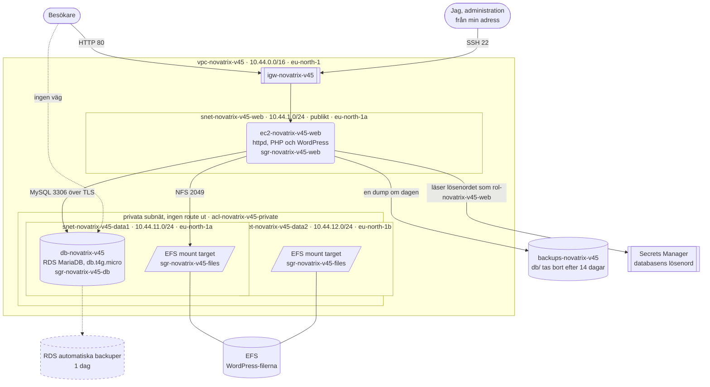
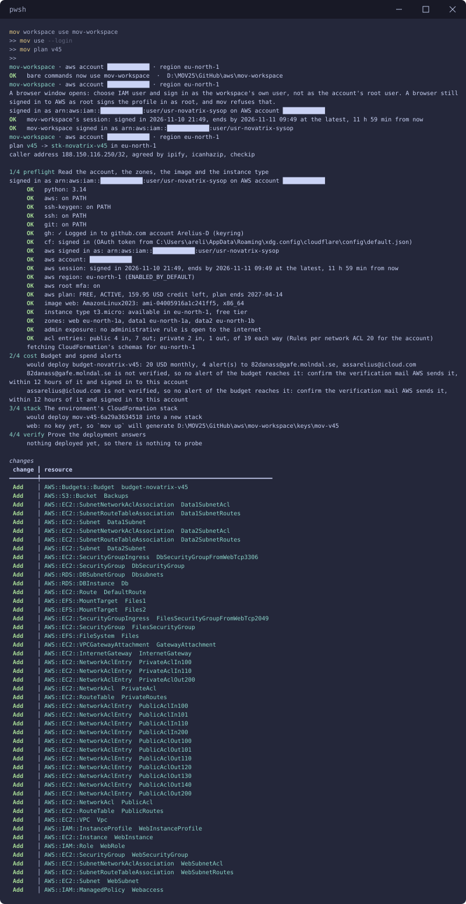
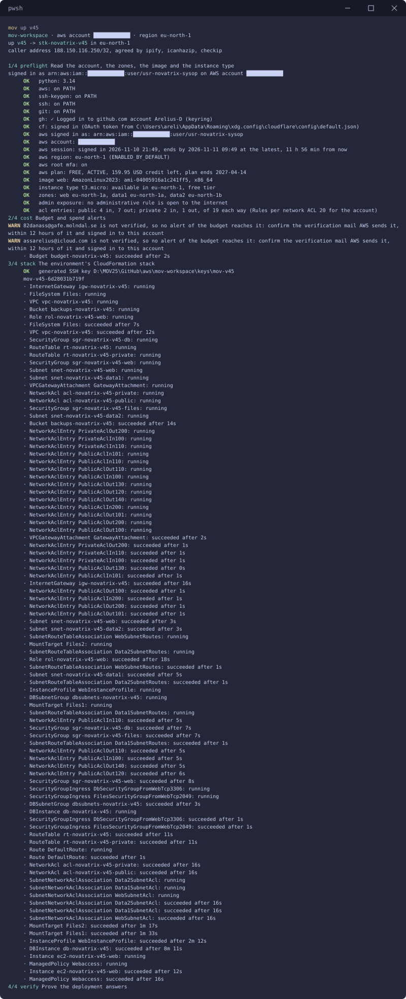
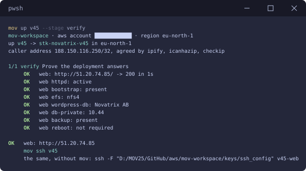
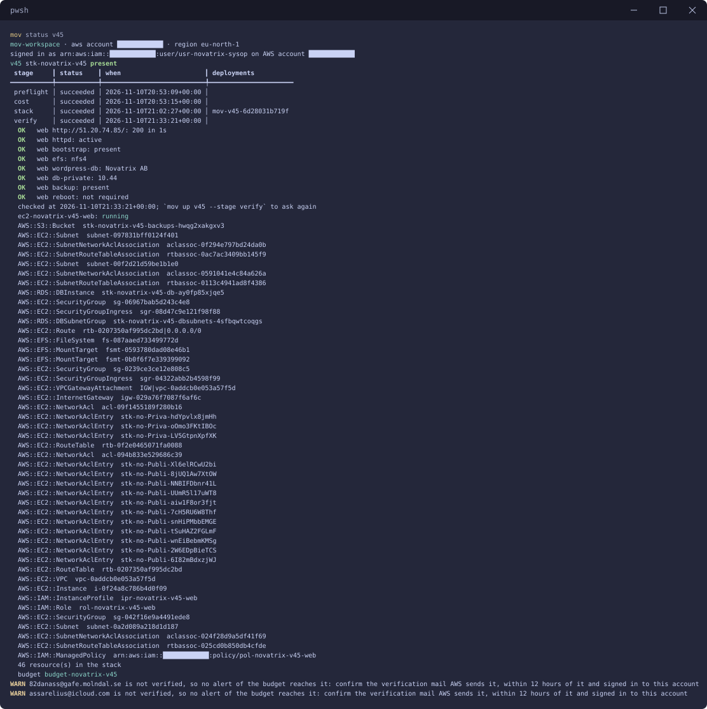

# v45 — Storage och databas

**Daniel Assarélius** · MOV25 · Amazon Web Services · Novatrix AB

Repo: [github.com/82danass/aws](https://github.com/82danass/aws) · Vecka: [v45](https://github.com/82danass/aws/tree/master/v45)

- [x] Skapa avsnitt för v45 och uppdatera README
- [x] Provisionera en databas i RDS med MariaDB/MySQL i ett privat subnät
- [x] Sätt upp delad lagring i EFS för WordPress-filerna
- [x] Skapa en S3-bucket för databasens backup, med livscykelregel på 14 dagar och automatisk backup i RDS
- [x] Installera WordPress och koppla den mot databasen och den delade lagringen
- [x] Säkra åtkomsten i lager
- [x] Verifiera och dokumentera

## Lösningen

WordPress på webbservern från v44, med databasen, filerna och backupen var för sig i stället för på maskinen. Nätverket är v44:s: ett publikt subnät för webbservern och två privata, ett i varje zon, för det som inte ska nås utifrån.

| Del | Tjänst | Var | Namn |
| --- | --- | --- | --- |
| Webbservern | EC2, Amazon Linux 2023, httpd och PHP | publikt subnät | `ec2-novatrix-v45-web` |
| Databasen | RDS för MariaDB | de privata subnäten | `db-novatrix-v45` |
| WordPress-filerna | EFS | en mount target i varje privat subnät | `stk-novatrix-v45` |
| Backupen | S3 | regionen | `backups-novatrix-v45` |
| Databasens lösenord | Secrets Manager | regionen | skapat och ägt av RDS |



## Databasen

| Val | Värde | Varför |
| --- | --- | --- |
| Motor | MariaDB | WordPress är byggt för MySQL och MariaDB. Uppgiften låter mig välja mellan dem. |
| Instansklass | `db.t4g.micro` | Free tier och räcker för en sida med få besökare. Graviton är billigare än motsvarande `t3`. |
| Disk | 20 GB gp2, krypterad | Det free tier täcker. WordPress databas är liten, det är filerna som växer och de ligger på EFS. |
| Placering | subnet group med data1 och data2 | RDS kräver subnät i två zoner. Databasen står i data1. |
| Publik | nej | `PubliclyAccessible: false` och ingen route ut ur de privata subnäten. |
| Multi-AZ | av | En standby i data2 dubblar kostnaden. I drift slås den på. |
| Lösenord | i Secrets Manager | `ManageMasterUserPassword` låter RDS skapa och äga lösenordet. Det står varken i repot, i profilen eller i mov. |
| Anslutning | TLS | RDS för MariaDB kräver krypterad anslutning (`require_secure_transport`). WordPress ansluter med `MYSQLI_CLIENT_SSL` och dumpen med `--ssl`. |

### Backup och lagringstid

Automatisk backup i RDS står på en dag, `BackupRetentionPeriod: 1`, som är det längsta Free plan tillåter. I drift hade jag valt **7 dagar**. Ett fel i databasen upptäcks inte alltid samma dag: en uppdatering av ett tillägg som förstör data på fredagen syns kanske först på måndagen. Sju dagar täcker en helg och lite till och ger återställning till valfri sekund under veckan. Längre tid än så kostar lagring varje dag utan att Novatrix behöver gå längre tillbaka. Den dagliga dumpen i S3 sparas dessutom i 14 dagar.

## Delad lagring

WordPress-filerna, alltså WordPress själv, teman, tillägg och uppladdade bilder, ligger på EFS och inte på maskinens disk. En andra webbserver ser samma filer. En webbserver som byggs om hittar dem kvar.

| Val | Värde | Varför |
| --- | --- | --- |
| Läge | General Purpose, Bursting | Rätt för många små filer. Bursting betalar bara för det som lagras. |
| Kryptering | på | Filerna är krypterade på disk. |
| Mount targets | en i data1 och en i data2 | En i varje zon som webbservrar kan stå i. |
| Montering | NFS 4.1 med AWS rekommenderade inställningar | `noresvport` tar klientens port ur 1024-65535, det område som NACL:erna släpper tillbaka svaren på. |

## Objektlagring och backup

Bucketen `backups-novatrix-v45` tar emot en dump av databasen varje dygn. En systemd-timer på webbservern kör `mysqldump` mot RDS och lägger resultatet komprimerat under `db/`. Den första dumpen görs direkt vid installationen.

| Inställning | Värde |
| --- | --- |
| Livscykelregel | allt under `db/` tas bort efter 14 dagar |
| Publik åtkomst | Block Public Access på alla fyra |
| Ägarskap | BucketOwnerEnforced, inga ACL:er |
| Kryptering | SSE-S3 |

Två backuper gör olika saker. RDS backup återställer databasen till en sekund i tiden men lever bara en dag här. Dumpen i S3 är en vanlig SQL-fil som går att läsa in i vilken MariaDB som helst. Den sparas i 14 dagar.

## WordPress

Ingen fil läggs på servern för hand. Vid första uppstarten klonar cloud-init repot och kör [`scripts/wordpress.sh`](../scripts/wordpress.sh) som root. Skriptet tar allt det behöver ur `/etc/mov/deploy.env`, som CloudFormation fyller i med databasens adress, hemligheten, filsystemet och bucketen:

1. installerar httpd, PHP, MariaDB-klienten och nfs-utils, samma paket som AWS egen WordPress-guide för Amazon Linux 2023
2. monterar EFS på `/var/www/html`
3. läser databasens användare och lösenord ur Secrets Manager med maskinens roll
4. laddar ner WordPress på svenska med wp-cli, skriver `wp-config.php` och installerar sidan mot RDS
5. sätter upp den dagliga dumpen till S3 och gör den första

Skriptet tål att köras igen. WordPress laddas bara ner och installeras om det inte redan finns på EFS.

Två fel kom fram i första körningen. wp-cli fick inte plats i PHP:s 128 MB när WordPress packades upp. RDS nekade anslutningen utan TLS. Båda är rättade i skriptet och skriptet kördes igen på samma server. Eftersom serverns första uppstart misslyckades räknar cloud-init den som misslyckad så länge maskinen finns. Kontrollen av cloud-init är därför inte med i verifieringen nedan. En ny maskin med `mov rebuild v45` kör skriptet rätt från början.

## Säkra åtkomsten i lager

| Lager | Var | Skyddar mot |
| --- | --- | --- |
| Route table utan route ut | data1, data2 | att databasen och filerna nås från internet eller själva når ut |
| `acl-novatrix-v45-private` | de privata subnäten | allt utom MySQL 3306 och NFS 2049 från webbsubnätet |
| `sgr-novatrix-v45-db` | databasen | allt utom 3306 från maskiner som bär `sgr-novatrix-v45-web` |
| `sgr-novatrix-v45-files` | EFS mount targets | allt utom 2049 från maskiner som bär `sgr-novatrix-v45-web` |
| `PubliclyAccessible: false` | databasen | att RDS ger databasen en publik adress |
| TLS | anslutningen till databasen | att lösenordet och datan läses på vägen |
| Rollen `rol-novatrix-v45-web` | webbservern | webbservern får läsa just databasens hemlighet och lägga dumpar under `db/`, inget annat |
| Block Public Access | bucketen | att backupen blir publik |
| Kryptering | RDS, EFS och S3 | att en disk eller ett objekt läses utanför tjänsten |

Webbserverns behörigheter står i policyn `pol-novatrix-v45-web`:

| Åtgärd | Resurs |
| --- | --- |
| `secretsmanager:GetSecretValue` | bara databasens hemlighet |
| `s3:PutObject` | bara `db/*` i backup-bucketen |
| `s3:ListBucket` | bara backup-bucketen |

## Verifiering







| Kontroll | Vad den visar | Svar |
| --- | --- | --- |
| sidan | WordPress svarar på den publika adressen med Novatrix-texten | `200` på 1 sekund |
| `httpd` | webbservern kör | `active` |
| `bootstrap` | skriptet har kört klart och lämnat sin stämpel | `present` |
| `efs` | WordPress-filerna ligger på EFS | `nfs4` |
| `wordpress-db` | WordPress läser sin titel ur databasen i RDS | `Novatrix AB` |
| `db-private` | databasens adress är privat | `10.44` |
| `backup` | en dump ligger i bucketen | `present` |

Från min dator mot sidan:

```powershell
curl -s -o NUL -w "%{http_code}`n" http://51.20.74.85/
curl -s http://51.20.74.85/ | Select-String "<title>"
```

```shell
200
<title>Novatrix AB</title>
```

Titeln kommer ur databasen: WordPress läser `blogname` ur RDS för varje sida den visar.



Efter varje delmoment går det att kontrollera för sig:

| Delmoment | Kontroll | Svar |
| --- | --- | --- |
| Databasen | `mov status v45` | `db-novatrix-v45` i stacken |
| Delad lagring | `mov up v45 --stage verify`, kontrollen `efs` | `nfs4` |
| Objektlagring och backup | kontrollen `backup` | `present` |
| WordPress mot databasen | kontrollen `wordpress-db` och `curl` | `Novatrix AB` |
| Säker åtkomst | kontrollen `db-private` | `10.44` |
| Allt på en gång | `mov up v45 --stage verify` | varje kontroll `OK` |

## Automatisering

Ingenting ovan är klickat fram i konsolen. Som i v42 till v44 bygger [mov](https://github.com/Arelius-D/mov) allt: **vad** som ska finnas står i profilen, **hur** det görs sköter verktyget. Databasen, filsystemet, bucketen och policyn står i profilens `resources` och blir en del av samma CloudFormation-stack som nätet och webbservern.

### Profil

[`mov-workspace/profiles/v45.json`](../mov-workspace/profiles/v45.json) bygger vidare på v44 med `extends`. Nätet, budgeten och sidans verifiering kommer därifrån. v45 lägger till NFS i NACL:erna, security groupen för filerna, rollen och resurserna:

```json
{
  "env": "v45",
  "extends": "v44",
  "description": "WordPress för Novatrix på nätverket från v44: databasen i RDS med MariaDB i de privata subnäten, WordPress-filerna på EFS och en daglig dump av databasen i en S3-bucket som tar bort dumpar äldre än 14 dagar. Databasen når bara webbservern och filerna bara webbservern.",
  "network": {
    "securityGroups": {
      "files": [
        { "name": "nfs", "ports": ["2049"], "source": "web" }
      ]
    },
    "acls": {
      "public": [
        { "name": "web-in", "priority": 100, "direction": "Inbound", "access": "Allow", "protocol": "Tcp", "ports": ["80", "443"], "source": "*", "destination": "*" },
        { "name": "ssh-in", "priority": 110, "direction": "Inbound", "access": "Allow", "protocol": "Tcp", "ports": ["22"], "source": "${admin.sshSource}", "destination": "*" },
        { "name": "replies-in", "priority": 200, "direction": "Inbound", "access": "Allow", "protocol": "Tcp", "ports": ["1024-65535"], "source": "*", "destination": "*" },
        { "name": "updates-out", "priority": 100, "direction": "Outbound", "access": "Allow", "protocol": "Tcp", "ports": ["80", "443"], "source": "*", "destination": "*" },
        { "name": "db-data1-out", "priority": 110, "direction": "Outbound", "access": "Allow", "protocol": "Tcp", "ports": ["3306"], "source": "*", "destination": "data1" },
        { "name": "db-data2-out", "priority": 120, "direction": "Outbound", "access": "Allow", "protocol": "Tcp", "ports": ["3306"], "source": "*", "destination": "data2" },
        { "name": "nfs-data1-out", "priority": 130, "direction": "Outbound", "access": "Allow", "protocol": "Tcp", "ports": ["2049"], "source": "*", "destination": "data1" },
        { "name": "nfs-data2-out", "priority": 140, "direction": "Outbound", "access": "Allow", "protocol": "Tcp", "ports": ["2049"], "source": "*", "destination": "data2" },
        { "name": "replies-out", "priority": 200, "direction": "Outbound", "access": "Allow", "protocol": "Tcp", "ports": ["1024-65535"], "source": "*", "destination": "*" }
      ],
      "private": [
        { "name": "db-from-web", "priority": 100, "direction": "Inbound", "access": "Allow", "protocol": "Tcp", "ports": ["3306"], "source": "web", "destination": "*" },
        { "name": "nfs-from-web", "priority": 110, "direction": "Inbound", "access": "Allow", "protocol": "Tcp", "ports": ["2049"], "source": "web", "destination": "*" },
        { "name": "replies-to-web", "priority": 200, "direction": "Outbound", "access": "Allow", "protocol": "Tcp", "ports": ["1024-65535"], "source": "*", "destination": "web" }
      ]
    }
  },
  "identity": {
    "userAssigned": [
      { "purpose": "web", "description": "Webbservern: läser databasens lösenord ur Secrets Manager och lägger dumpar i backup-bucketen, inget annat." }
    ]
  },
  "compute": {
    "vms": [
      {
        "purpose": "web",
        "image": "AmazonLinux2023",
        "subnet": "web",
        "securityGroup": "web",
        "app": true,
        "identities": ["web"],
        "environment": {
          "DB_HOST": "@attribute:db.Endpoint.Address",
          "DB_NAME": "wordpress",
          "DB_SECRET": "@attribute:db.MasterUserSecret.SecretArn",
          "EFS_ID": "@resourceId:files",
          "BACKUP_BUCKET": "@resourceId:backups"
        },
        "source": {
          "repo": "82danass/aws",
          "ref": "master",
          "path": "v45",
          "bootstrap": "scripts/wordpress.sh",
          "auth": "public"
        }
      }
    ]
  },
  "resources": [
    {
      "type": "AWS::RDS::DBSubnetGroup",
      "purpose": "dbsubnets",
      "properties": {
        "DBSubnetGroupDescription": "De två privata subnäten, ett i varje zon.",
        "SubnetIds": ["@output:network.subnet.data1", "@output:network.subnet.data2"]
      }
    },
    {
      "type": "AWS::RDS::DBInstance",
      "purpose": "db",
      "properties": {
        "Engine": "mariadb",
        "DBInstanceClass": "db.t4g.micro",
        "AllocatedStorage": "20",
        "StorageType": "gp2",
        "StorageEncrypted": true,
        "DBName": "wordpress",
        "MasterUsername": "wpadmin",
        "ManageMasterUserPassword": true,
        "DBSubnetGroupName": "@resourceId:dbsubnets",
        "VPCSecurityGroups": ["@output:network.securityGroup.db"],
        "PubliclyAccessible": false,
        "MultiAZ": false,
        "BackupRetentionPeriod": 1,
        "DeleteAutomatedBackups": true,
        "DeletionProtection": false
      }
    },
    {
      "type": "AWS::EFS::FileSystem",
      "purpose": "files",
      "properties": {
        "Encrypted": true,
        "PerformanceMode": "generalPurpose",
        "ThroughputMode": "bursting"
      }
    },
    {
      "type": "AWS::EFS::MountTarget",
      "purpose": "files1",
      "properties": {
        "FileSystemId": "@resourceId:files",
        "SubnetId": "@output:network.subnet.data1",
        "SecurityGroups": ["@output:network.securityGroup.files"]
      }
    },
    {
      "type": "AWS::EFS::MountTarget",
      "purpose": "files2",
      "properties": {
        "FileSystemId": "@resourceId:files",
        "SubnetId": "@output:network.subnet.data2",
        "SecurityGroups": ["@output:network.securityGroup.files"]
      }
    },
    {
      "type": "AWS::S3::Bucket",
      "purpose": "backups",
      "properties": {
        "PublicAccessBlockConfiguration": { "BlockPublicAcls": true, "BlockPublicPolicy": true, "IgnorePublicAcls": true, "RestrictPublicBuckets": true },
        "OwnershipControls": { "Rules": [{ "ObjectOwnership": "BucketOwnerEnforced" }] },
        "BucketEncryption": { "ServerSideEncryptionConfiguration": [{ "ServerSideEncryptionByDefault": { "SSEAlgorithm": "AES256" } }] },
        "LifecycleConfiguration": { "Rules": [{ "Id": "db-dumps", "Status": "Enabled", "Prefix": "db/", "ExpirationInDays": 14 }] }
      }
    },
    {
      "type": "AWS::IAM::ManagedPolicy",
      "purpose": "webaccess",
      "name": "pol-novatrix-${env}-web",
      "properties": {
        "ManagedPolicyName": "pol-novatrix-${env}-web",
        "Description": "Webbserverns behörigheter: läsa databasens lösenord och lägga dumpar under db/ i backup-bucketen.",
        "Roles": ["@resourceId:web"],
        "PolicyDocument": {
          "Version": "2012-10-17",
          "Statement": [
            { "Sid": "ReadDbSecret", "Effect": "Allow", "Action": "secretsmanager:GetSecretValue", "Resource": "@attribute:db.MasterUserSecret.SecretArn" },
            { "Sid": "WriteDumps", "Effect": "Allow", "Action": "s3:PutObject", "Resource": { "Fn::Sub": "${Backups.Arn}/db/*" } },
            { "Sid": "ListDumps", "Effect": "Allow", "Action": "s3:ListBucket", "Resource": "@attribute:backups.Arn" }
          ]
        }
      }
    }
  ],
  "verify": {
    "timeoutSeconds": 900,
    "host": [
      { "name": "httpd", "run": "systemctl is-active httpd", "expect": "active" },
      { "name": "bootstrap", "run": "test -f /etc/mov/deployed.json && echo present", "expect": "present" },
      { "name": "efs", "run": "findmnt -n -o FSTYPE --target /var/www/html/wp-content", "expect": "nfs4" },
      { "name": "wordpress-db", "run": "sudo /usr/local/bin/wp --path=/var/www/html --allow-root option get blogname", "expect": "Novatrix AB" },
      { "name": "db-private", "run": ". /etc/mov/deploy.env && getent hosts \"$DB_HOST\" | awk '{print $1}' | cut -d. -f1-2", "expect": "10.44" },
      { "name": "backup", "run": ". /etc/mov/deploy.env && aws s3 ls \"s3://$BACKUP_BUCKET/db/\" --region eu-north-1 | grep -q 'sql.gz$' && echo present", "expect": "present" }
    ]
  }
}
```

`@attribute:db.Endpoint.Address` och `@attribute:db.MasterUserSecret.SecretArn` fylls i av CloudFormation när databasen finns. Därför skapas webbservern efter databasen. Därför vet också skriptet var databasen är utan att något står i repot.

### Återskapa miljön från repot

```powershell
git clone https://github.com/82danass/aws.git
mov setup --aws .\aws\mov-workspace
mov workspace use mov-workspace
mov check --fix
mov up v45
```

En inloggning i AWS CLI varar högst tolv timmar, så nästa dag är det `mov use --login` först.

### Riva miljön när jag är klar

```powershell
mov down v45 -y --wait
```

Bucketen töms först eftersom CloudFormation inte raderar en bucket som innehåller något. Sedan går budgeten, stacken, SSH-posten och nyckeln. CloudFormation tar en sista snapshot av databasen när den raderas, så den ligger kvar under RDS snapshots tills den tas bort.
