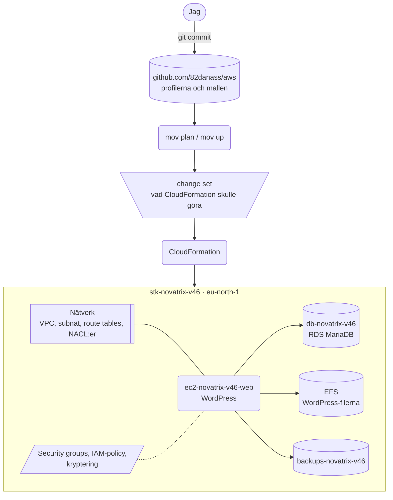
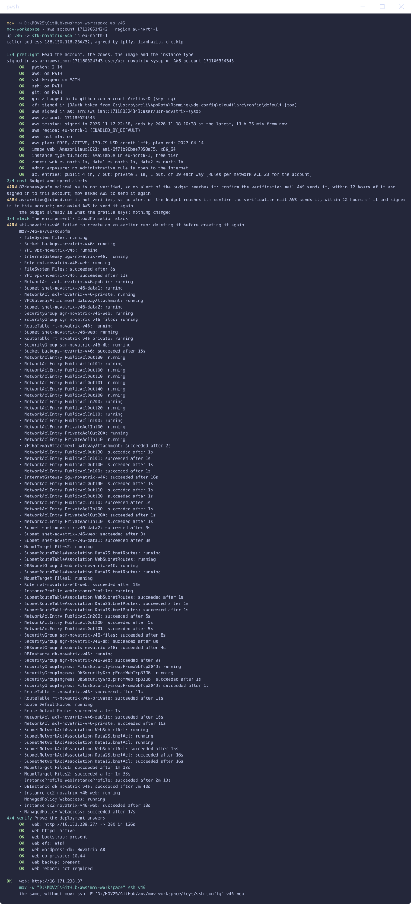
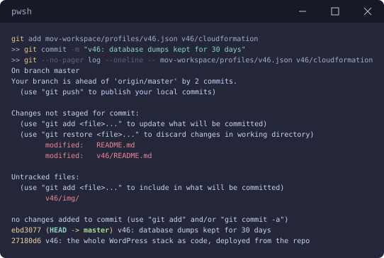

# v46 — IaC med CloudFormation

**Daniel Assarélius** · MOV25 · Amazon Web Services · Novatrix AB

Repo: [github.com/82danass/aws](https://github.com/82danass/aws) · Vecka: [v46](https://github.com/82danass/aws/tree/master/v46)

- [x] Skapa avsnitt för v46 med templates versionshanterade i repot
- [x] Skriv CloudFormation-template(s) för centrala delar av stacken
- [x] Deploya stacken från kod
- [x] Visa versionshantering (ändring och historik)
- [x] Dokumentera hur stacken återskapas

## Stacken som kod

Hela WordPress-stacken från v42 till v45 står som kod i repot och byggs som en enda CloudFormation-stack, `stk-novatrix-v46`. Nätverk, compute, databas, lagring och säkerhet hör till samma stack och skapas, ändras och rivs tillsammans.

| Lager | Resurser i stacken | Namn |
| --- | --- | --- |
| Nätverk | VPC, internet gateway, ett publikt och två privata subnät, två route tables, två NACL:er med sina regler | `vpc-novatrix-v46`, `snet-novatrix-v46-web`, `-data1`, `-data2` |
| Compute | EC2 med Amazon Linux 2023, roll och instance profile | `ec2-novatrix-v46-web`, `rol-novatrix-v46-web` |
| Databas | RDS för MariaDB och dess subnet group | `db-novatrix-v46` |
| Lagring | EFS med en mount target i varje privat subnät, S3 för backupen | `backups-novatrix-v46` |
| Säkerhet | security groups för webben, databasen och filerna, IAM-policyn, Block Public Access, kryptering | `sgr-novatrix-v46-web`, `-db`, `-files`, `pol-novatrix-v46-web` |



## Koden i repot

| Fil | Vad den håller |
| --- | --- |
| [`mov-workspace/profiles/v46.json`](../mov-workspace/profiles/v46.json) | veckans profil: databasen, filerna, bucketen och policyn, resten ärvt |
| [`mov-workspace/profiles/v45.json`](../mov-workspace/profiles/v45.json) | webbservern med WordPress, NFS i NACL:erna och rollen |
| [`mov-workspace/profiles/v44.json`](../mov-workspace/profiles/v44.json) | nätverket i lager |
| [`mov-workspace/profiles/v42.json`](../mov-workspace/profiles/v42.json) | budgeten och verifieringen av sidan |
| [`mov-workspace/aws-defaults.json`](../mov-workspace/aws-defaults.json) | taggarna, instanstypen, disken och användaren på maskinen |
| [`mov-workspace/naming.json`](../mov-workspace/naming.json) | namnmönstren |
| [`scripts/wordpress.sh`](../scripts/wordpress.sh) | WordPress på servern |
| [`v46/cloudformation/stack.template.json`](cloudformation/stack.template.json) | CloudFormation-mallen som deployades |
| [`v46/cloudformation/stack.parameters.json`](cloudformation/stack.parameters.json) | mallens parametrar: maskinens image och dess cloud-init |
| [`v46/cloudformation/stack.tags.json`](cloudformation/stack.tags.json) | stackens taggar |

Profilen är koden jag skriver. Den säger **vad** stacken ska innehålla. [mov](https://github.com/Arelius-D/mov) bygger CloudFormation-mallen av den och deployar den genom ett change set. Mallen i `v46/cloudformation` är exakt den CloudFormation fick, inte en avskrift av den.

Det som varierar är parametriserat:

| Vad | Hur |
| --- | --- |
| Miljöns namn | Varje namn i stacken byggs av `env` genom `naming.json`. Samma kod med ett annat `env` ger en andra stack bredvid den första. |
| Det som är gemensamt | `extends`: v46 ärver v45, som ärver v44 och v42. En ändring i v44:s nätverk gäller alla veckor som bygger på det. |
| Min adress för SSH | `@caller`: mov tar reda på adressen vid varje körning, ingen adress står i koden. |
| Maskinens image | parametern `WebImage`, den aktuella Amazon Linux 2023 ur SSM när maskinen byggs |
| Maskinens uppstart | parametern `WebUserData`, cloud-init med SSH-nyckeln och databasens, filsystemets och bucketens namn ur stacken |
| Databasens lösenord | ingen parameter: RDS skapar det och lägger det i Secrets Manager |
| Ett värde för en enda körning | `--set`, till exempel en annan instanstyp utan att röra profilen |

[`mov-workspace/profiles/v46.json`](../mov-workspace/profiles/v46.json)

```json
{
  "env": "v46",
  "extends": "v45",
  "description": "Hela WordPress-stacken för Novatrix som kod i en CloudFormation-stack: nätverket från v44, webbservern med WordPress, databasen i RDS, filerna på EFS och backupen i S3 från v45. Profilen äger datadelen själv, så att veckans ändring syns som en rad i historiken.",
  "resources": [
    {
      "type": "AWS::RDS::DBSubnetGroup",
      "purpose": "dbsubnets",
      "properties": {
        "DBSubnetGroupDescription": "De två privata subnäten, ett i varje zon.",
        "SubnetIds": [
          "@output:network.subnet.data1",
          "@output:network.subnet.data2"
        ]
      }
    },
    {
      "type": "AWS::RDS::DBInstance",
      "purpose": "db",
      "properties": {
        "Engine": "mariadb",
        "DBInstanceClass": "db.t4g.micro",
        "AllocatedStorage": "20",
        "StorageType": "gp2",
        "StorageEncrypted": true,
        "DBName": "wordpress",
        "MasterUsername": "wpadmin",
        "ManageMasterUserPassword": true,
        "DBSubnetGroupName": "@resourceId:dbsubnets",
        "VPCSecurityGroups": [
          "@output:network.securityGroup.db"
        ],
        "PubliclyAccessible": false,
        "MultiAZ": false,
        "BackupRetentionPeriod": 1,
        "DeleteAutomatedBackups": true,
        "DeletionProtection": false
      }
    },
    {
      "type": "AWS::EFS::FileSystem",
      "purpose": "files",
      "properties": {
        "Encrypted": true,
        "PerformanceMode": "generalPurpose",
        "ThroughputMode": "bursting"
      }
    },
    {
      "type": "AWS::EFS::MountTarget",
      "purpose": "files1",
      "properties": {
        "FileSystemId": "@resourceId:files",
        "SubnetId": "@output:network.subnet.data1",
        "SecurityGroups": [
          "@output:network.securityGroup.files"
        ]
      }
    },
    {
      "type": "AWS::EFS::MountTarget",
      "purpose": "files2",
      "properties": {
        "FileSystemId": "@resourceId:files",
        "SubnetId": "@output:network.subnet.data2",
        "SecurityGroups": [
          "@output:network.securityGroup.files"
        ]
      }
    },
    {
      "type": "AWS::S3::Bucket",
      "purpose": "backups",
      "properties": {
        "PublicAccessBlockConfiguration": {
          "BlockPublicAcls": true,
          "BlockPublicPolicy": true,
          "IgnorePublicAcls": true,
          "RestrictPublicBuckets": true
        },
        "OwnershipControls": {
          "Rules": [
            {
              "ObjectOwnership": "BucketOwnerEnforced"
            }
          ]
        },
        "BucketEncryption": {
          "ServerSideEncryptionConfiguration": [
            {
              "ServerSideEncryptionByDefault": {
                "SSEAlgorithm": "AES256"
              }
            }
          ]
        },
        "LifecycleConfiguration": {
          "Rules": [
            {
              "Id": "db-dumps",
              "Status": "Enabled",
              "Prefix": "db/",
              "ExpirationInDays": 30
            }
          ]
        }
      }
    },
    {
      "type": "AWS::IAM::ManagedPolicy",
      "purpose": "webaccess",
      "name": "pol-novatrix-${env}-web",
      "properties": {
        "ManagedPolicyName": "pol-novatrix-${env}-web",
        "Description": "Webbserverns behörigheter: läsa databasens lösenord och lägga dumpar under db/ i backup-bucketen.",
        "Roles": [
          "@resourceId:web"
        ],
        "PolicyDocument": {
          "Version": "2012-10-17",
          "Statement": [
            {
              "Sid": "ReadDbSecret",
              "Effect": "Allow",
              "Action": "secretsmanager:GetSecretValue",
              "Resource": "@attribute:db.MasterUserSecret.SecretArn"
            },
            {
              "Sid": "WriteDumps",
              "Effect": "Allow",
              "Action": "s3:PutObject",
              "Resource": {
                "Fn::Sub": "${Backups.Arn}/db/*"
              }
            },
            {
              "Sid": "ListDumps",
              "Effect": "Allow",
              "Action": "s3:ListBucket",
              "Resource": "@attribute:backups.Arn"
            }
          ]
        }
      }
    }
  ]
}
```

## Deploya från kod



| Kontroll | Vad den visar | Svar |
| --- | --- | --- |
| sidan | WordPress svarar på den publika adressen med Novatrix-texten | `200` |
| `httpd` | webbservern kör | `active` |
| `bootstrap` | skriptet har kört klart och lämnat sin stämpel | `present` |
| `efs` | WordPress-filerna ligger på EFS | `nfs4` |
| `wordpress-db` | WordPress läser sin titel ur databasen i RDS | `Novatrix AB` |
| `db-private` | databasens adress är privat | `10.44` |
| `backup` | en dump ligger i bucketen | `present` |

## Versionshantering

Veckans ändring: dumparna i backup-bucketen sparas i 30 dagar i stället för 14. En rad i profilen.

```diff
-            "ExpirationInDays": 14
+            "ExpirationInDays": 30
```



Nästa `mov up v46` för ut ändringen. `mov plan v46` visar den först som ett change set: `Modify AWS::S3::Bucket Backups` och policyn `Webaccess` som pekar på bucketen.

Ändringen följer samma väg som allt annat i stacken: den skrivs i koden, granskas som en diff, prövas med `mov plan` och deployas med `mov up`. CloudFormation ändrar bucketens livscykelregel på plats. Inget annat i stacken rörs.

Versionshantering gör detta för drift och samarbete:

| | |
| --- | --- |
| Spårbarhet | Varje ändring av stacken är en commit med vem, när och varför. Historiken svarar på vad som ändrades i stället för att någon minns det. |
| Granskning före deploy | Diffen visar raden som ändras och `mov plan` visar vad CloudFormation kommer att göra innan något görs. |
| Tillbaka till det som fungerade | Ett fel rättas med `git revert` och en ny `mov up`. Stacken blir det den var. |
| Samarbete | Flera kan arbeta i egna brancher och slå ihop genom pull requests. Ingen ändrar i konsolen bakom ryggen på någon annan. |
| En sanning | Repot är beskrivningen av stacken. Det som står i konsolen och inte i repot finns inte på riktigt. |

## Återskapa stacken från repot

Inget steg kräver ett klick i konsolen. Arbetsytans fil `mov.workspace.json` ligger inte i repot eftersom den bär kontots id. `mov setup --aws` skriver den.

```powershell
git clone https://github.com/82danass/aws.git
mov setup --aws .\aws\mov-workspace
mov -w .\aws\mov-workspace check
mov -w .\aws\mov-workspace up v46
```

Resultatet blir samma stack med samma namn, samma region och samma verifiering. En inloggning i AWS CLI varar högst tolv timmar, så nästa dag är det `mov -w .\aws\mov-workspace use --login` först.

## Riva miljön när jag är klar

```powershell
mov -w D:\MOV25\GitHub\aws\mov-workspace down v46 -y --wait
```

Bucketen töms först eftersom CloudFormation inte raderar en bucket som innehåller något. Sedan går budgeten, stacken med sina 46 resurser, SSH-posten och nyckeln. Databasens sista snapshot, som CloudFormation tar när databasen raderas, raderar mov när stacken är borta. Nästa `mov up v46` bygger samma stack igen från repot.
