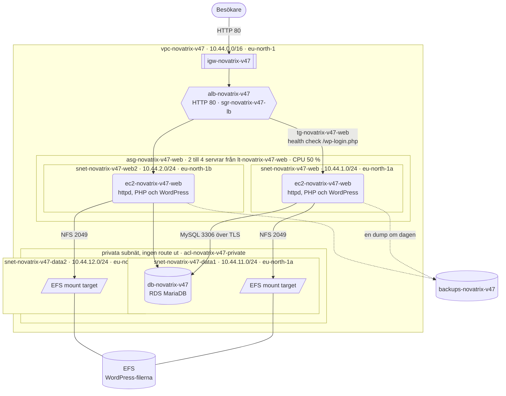
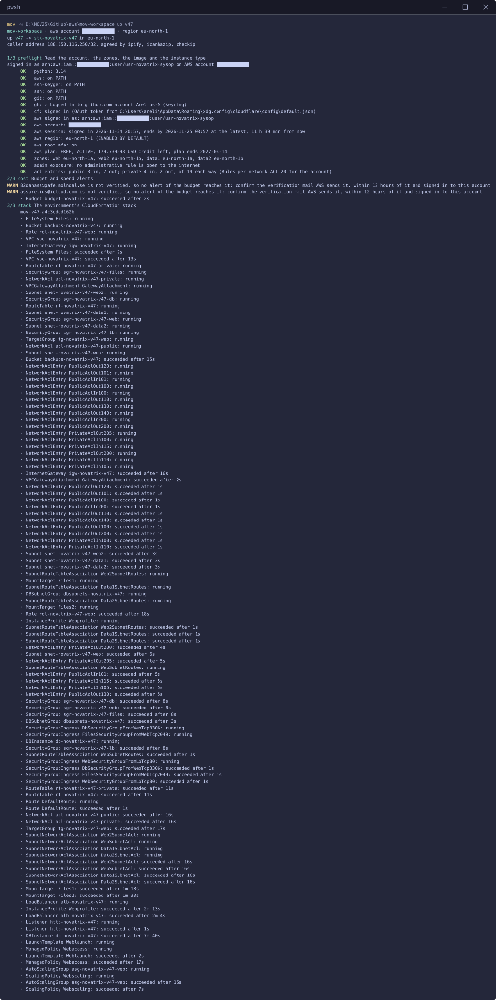

# v47 — Skalbarhet och tillgänglighet

**Daniel Assarélius** · MOV25 · Amazon Web Services · Novatrix AB

Repo: [github.com/82danass/aws](https://github.com/82danass/aws) · Vecka: [v47](https://github.com/82danass/aws/tree/master/v47)

- [x] Skapa avsnitt för v47 och uppdatera README
- [x] Skapa ett launch template för WordPress-instansen
- [x] Sätt upp en Auto Scaling-grupp över flera Availability Zones
- [x] Placera en Application Load Balancer med health checks framför gruppen
- [x] Beräkna månadskostnaden med AWS Pricing Calculator
- [x] Verifiera och dokumentera

## Lösningen

WordPress-stacken från v46 med webbservern ersatt av en grupp servrar. En Application Load Balancer i två zoner tar emot all trafik och skickar den vidare till de servrar i gruppen som klarar sin health check. Servrarna startas från ett launch template och delar databasen i RDS, filerna på EFS och backupen i S3.

| Del | Tjänst | Var | Namn |
| --- | --- | --- | --- |
| Lastbalanseraren | Application Load Balancer, HTTP 80 | de publika subnäten i eu-north-1a och eu-north-1b | `alb-novatrix-v47` |
| Målgruppen | target group med health check på `/wp-login.php` | VPC:t | `tg-novatrix-v47-web` |
| Servrarnas mall | launch template, Amazon Linux 2023, t3.micro | regionen | `lt-novatrix-v47-web` |
| Servrarna | Auto Scaling-grupp, två till fyra servrar | de publika subnäten i båda zonerna | `asg-novatrix-v47-web`, servrarna `ec2-novatrix-v47-web` |
| Databasen | RDS för MariaDB | de privata subnäten | `db-novatrix-v47` |
| WordPress-filerna | EFS med en mount target i varje zon | de privata subnäten | filsystemets id ur stacken |
| Backupen | S3, dumpar under `db/` i 30 dagar | regionen | `backups-novatrix-v47` |
| Servrarnas behörigheter | IAM-roll, instance profile och policy | kontot | `rol-novatrix-v47-web`, `ipr-novatrix-v47-web`, `pol-novatrix-v47-web` |



## Launch template

`lt-novatrix-v47-web` är mallen för en WordPress-server. Gruppen startar varje server från den.

| Inställning | Värde |
| --- | --- |
| Image | den senaste Amazon Linux 2023, läst ur SSM-parametern `/aws/service/ami-amazon-linux-latest/al2023-ami-kernel-default-x86_64` när mallen skapas |
| Instanstyp | `t3.micro` |
| Disk | 8 GB gp3, krypterad, raderas med servern |
| Nätverk | publik adress för paketen ut, security group `sgr-novatrix-v47-web` |
| Behörigheter | instance profile `ipr-novatrix-v47-web` med rollen `rol-novatrix-v47-web` |
| Metadata | bara IMDSv2 (`HttpTokens: required`) |
| Taggar | `Name`, `env` och `managedBy` på servern och dess disk, så att budgeten räknar dem |
| User data | cloud-init som klonar repot och kör [`v47/wordpress.sh`](wordpress.sh) |

Skriptet är v45:s och v46:s med tre ändringar för flera servrar. Sidans adress är lastbalanserarens, inte en servers. WordPress installeras under ett lås på EFS, så att två servrar som startar samtidigt inte båda installerar. Dumpen till S3 görs en gång om dagen av den server som hinner först, inte en gång per server.

## Auto Scaling-gruppen

`asg-novatrix-v47-web` håller mellan två och fyra servrar, normalt två, utspridda över subnäten `web` i eu-north-1a och `web2` i eu-north-1b.

| Inställning | Värde | Varför |
| --- | --- | --- |
| Min, önskat, max | 2, 2, 4 | två servrar i var sin zon klarar att en faller bort, fyra är taket för kostnaden |
| Zoner | eu-north-1a och eu-north-1b | gruppen fördelar servrarna jämnt och startar om i den zon som fungerar |
| Health check | `ELB` | en server som lastbalanseraren inte får svar från byts ut, inte bara en som har stannat |
| Grace period | 900 sekunder | den första starten installerar paket och WordPress innan servern kan svara |
| Skalning | target tracking på medel-CPU 50 % | gruppen lägger till servrar när medel-CPU ligger över 50 % och tar bort dem när den ligger under |

## Application Load Balancer

`alb-novatrix-v47` är internet-facing och står i båda publika subnäten. Lyssnaren på port 80 skickar allt till målgruppen `tg-novatrix-v47-web`, som gruppen själv registrerar sina servrar i.

| Health check | Värde |
| --- | --- |
| Sökväg | `/wp-login.php`, som bara svarar när httpd, PHP, filerna på EFS och databasen fungerar |
| Svar som räknas som friskt | `200` |
| Intervall och timeout | var 15:e sekund, 5 sekunder |
| Frisk efter, sjuk efter | 2 svar i rad, 3 uteblivna i rad |
| Deregistration delay | 30 sekunder |

## Säkerhet i lager

Servrarna nås inte längre direkt från internet. Bara lastbalanseraren tar emot trafik utifrån.

| Lager | Regel |
| --- | --- |
| `sgr-novatrix-v47-lb` | HTTP 80 från alla |
| `sgr-novatrix-v47-web` | HTTP 80 bara från lastbalanserarens security group |
| `sgr-novatrix-v47-db` | MySQL 3306 bara från servrarnas security group |
| `sgr-novatrix-v47-files` | NFS 2049 bara från servrarnas security group |
| `acl-novatrix-v47-public` | HTTP och HTTPS in, svar tillbaka, paket, databasen och filerna ut |
| `acl-novatrix-v47-private` | MySQL och NFS in bara från de två publika subnäten, svar bara tillbaka till dem |

Servrarna har ingen SSH-nyckel och ingen regel för SSH.

## Koden i repot

| Fil | Vad den håller |
| --- | --- |
| [`mov-workspace/profiles/v47.json`](../mov-workspace/profiles/v47.json) | veckans profil: hela stacken, nätverket med det andra publika subnätet, mallen, gruppen, lastbalanseraren och datadelen från v46 |
| [`v47/wordpress.sh`](wordpress.sh) | WordPress på varje server i gruppen |
| [`mov-workspace/aws-defaults.json`](../mov-workspace/aws-defaults.json) | taggarna |
| [`mov-workspace/naming.json`](../mov-workspace/naming.json) | namnmönstren |

Profilen ärver inte längre v46. Webbservern i v42 till v46 var en enda maskin och v47 har ingen, så profilen äger hela stacken själv.

## Deploya från kod



`mov up v47` bygger stacken `stk-novatrix-v47` med 58 resurser. När stacken är klar startar gruppen sina två servrar, som installerar paketen och WordPress och svarar på sin health check efter ungefär tre minuter.

## Verifiering

Allt läst ur AWS efter `mov up v47`.

| Kontroll | Vad den visar | Svar |
| --- | --- | --- |
| sidan | WordPress svarar på lastbalanserarens adress med Novatrix-texten | `200`, titeln `Novatrix AB` |
| health check | `/wp-login.php` på varje server i målgruppen | båda `healthy` |
| zonerna | servrarna i gruppen | en i eu-north-1a och en i eu-north-1b, båda `InService` |
| gruppens storlek | min, önskat, max | `2`, `2`, `4` |
| servern direkt | en servers egen publika adress på port 80 | inget svar, bara lastbalanseraren kommer in |
| databasen | `PubliclyAccessible` | `False` |
| backupen | dumpar i bucketen efter att båda servrarna har kört skriptet | en dump, den andra servern hoppade över sin |

```powershell
aws elbv2 describe-target-health --profile mov-workspace --target-group-arn (aws elbv2 describe-target-groups --profile mov-workspace --names tg-novatrix-v47-web --query 'TargetGroups[0].TargetGroupArn' --output text)
aws autoscaling describe-auto-scaling-groups --profile mov-workspace --auto-scaling-group-names asg-novatrix-v47-web --query 'AutoScalingGroups[0].Instances[].[InstanceId,AvailabilityZone,HealthStatus]' --output table
```

## Tillgänglighet: en server faller bort

Jag avslutade servern i eu-north-1a medan sidan frågades var tionde sekund genom lastbalanseraren.

```powershell
aws autoscaling terminate-instance-in-auto-scaling-group --profile mov-workspace --instance-id i-00983e10ada873ad5 --no-should-decrement-desired-capacity
```

| Steg | Vad som hände |
| --- | --- |
| Servern avslutas | lastbalanseraren slutar skicka trafik till den (`draining`) och servern i eu-north-1b tar allt |
| 11 sekunder senare | gruppen startar en ny server från launch template i eu-north-1a, där det nu saknades en |
| Den nya servern startar | den hittar WordPress på EFS, väntar på låset och installerar ingenting |
| Efter 2 minuter | den nya servern är `healthy` och gruppen har två friska servrar igen |
| Under hela tiden | sidan frågades 12 gånger och svarade `200` varje gång |

## Återskapa stacken från repot

```powershell
git clone https://github.com/82danass/aws.git
mov setup --aws .\aws\mov-workspace
mov -w .\aws\mov-workspace check
mov -w .\aws\mov-workspace up v47
```

Servrarna klonar repot från GitHub när de startar, så det som står i `master` är det som körs.

## Månadskostnad

Beräknad i AWS Pricing Calculator i kontots Billing and Cost Management, som workload estimate `novatrix-v47`: en rad per sak stacken kör, en månad av den, med on-demand-priserna i eu-north-1 och 730 timmar i månaden.

| Grupp | Tjänst | Vad | Mängd i månaden | Per månad |
| --- | --- | --- | --- | --- |
| Servrarna | EC2 | 2 × t3.micro, Linux | 1 460 timmar | 15,77 USD |
| Servrarna | EBS | 2 × 8 GB gp3 | 16 GB-månader | 1,34 USD |
| Lastbalanseraren | Elastic Load Balancing | 1 Application Load Balancer | 730 timmar | 17,48 USD |
| Lastbalanseraren | Elastic Load Balancing | kapacitetsenheter för lite trafik, 0,04 LCU | 29,2 LCU-timmar | 0,22 USD |
| Nätverket | VPC | 4 publika IPv4-adresser: två servrar och lastbalanseraren i två zoner | 2 920 timmar | 14,60 USD |
| Databasen | RDS för MariaDB | db.t4g.micro, Single-AZ | 730 timmar | 11,68 USD |
| Databasen | RDS för MariaDB | 20 GB gp2 | 20 GB-månader | 2,40 USD |
| Databasen | Secrets Manager | databasens lösenord | 1 secret | 0,40 USD |
| Filerna | EFS | Standard | 1 GB-månad | 0,30 USD |
| Backupen | S3 | dumparna | 0,1 GB-månad | 0,00 USD |
| | | **Totalt med två servrar** | | **64,19 USD** |

Med fyra servrar, gruppens tak, blir det 88,59 USD.

## Riva miljön när jag är klar

```powershell
mov -w D:\MOV25\GitHub\aws\mov-workspace down v47 -y --wait
```

Bucketen töms först eftersom CloudFormation inte raderar en bucket som innehåller något. Sedan går budgeten och stacken: lastbalanseraren, gruppen med sina servrar, mallen, databasen och resten. Databasens sista snapshot, som CloudFormation tar när databasen raderas, raderar mov när stacken är borta. Nästa `mov up v47` bygger samma stack igen från repot.
